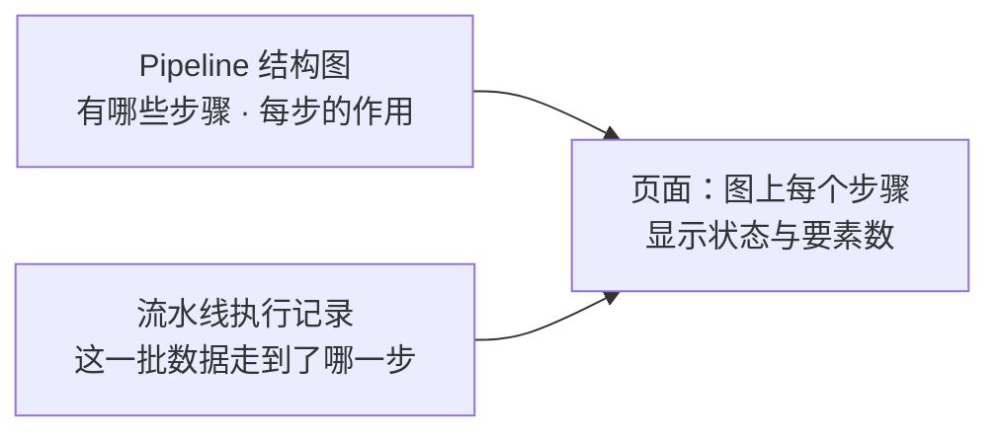
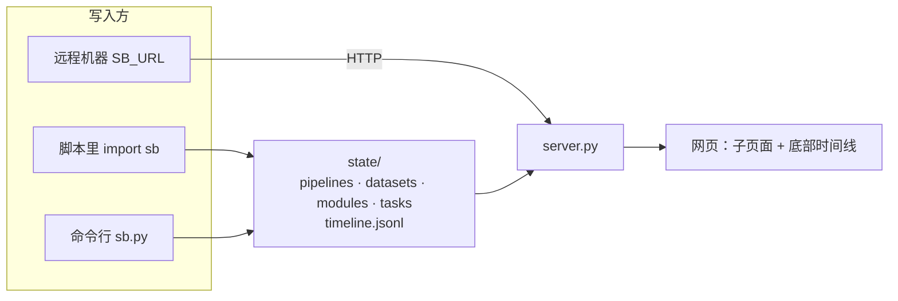
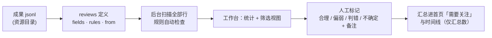
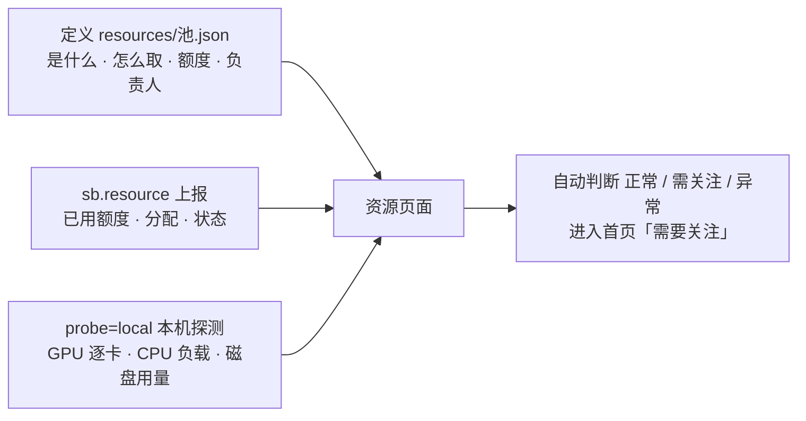
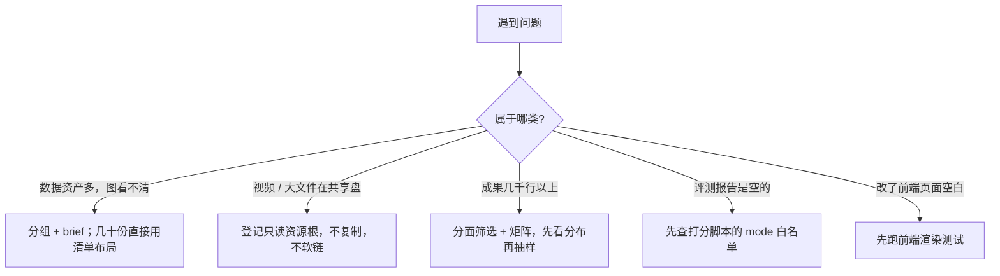

# status_board

通用、可移植的状态看板：**Pipeline 结构图（节点带中文作用标注）**、**数据管理（多地址 + 来源/用处/处理情况；可画成关系图，也可按分组列成模块化清单）**、**进程记录（训练 / 流水线执行 / 评测）**、**定制展示模块**，并用**时间线**回放变化过程（以动画过渡而非直接切换）。

只依赖 Python 3.8+ 标准库，前端无 CDN、无构建步骤，整个目录拷走即可用。

## 用途

**在本机启动一个 web 服务，用来监督本地正在运行的东西**：训练跑到哪了、流水线处理到哪一步、评测进度、数据放在哪、GPU / 磁盘 / API Key 额度够不够。

- **纯本地运行，不需要推送到云端**：没有账号、没有云服务、不联网也能用。数据只存在本目录的 `state/` 里，默认只监听 `127.0.0.1`。
- 你的脚本把进度写进 `state/`，网页每 2.5 秒自动刷新；底部时间线可以回放过去发生了什么。

## 使用方法

**1. 启动服务**

```bash
cd status_board
python3 server.py                     # 默认 http://127.0.0.1:8765
python3 server.py --port 38417        # 端口被占用时换一个
nohup python3 server.py --port 38417 > /tmp/sb_server.log 2>&1 &     # 放到后台常驻
```

**2. 打开网页**：浏览器访问 `http://127.0.0.1:<端口>/`。如果服务跑在远程开发机上，需要先把该端口转发到本地再访问。

**3. 在你的脚本里上报进度**（和服务在同一台机器上时直接写 `state/`，不需要网络）

```python
import sb      # 把本目录加入 sys.path，或拷贝 sb.py + sbstore.py 到你的项目
for x in sb.track(items, "my-job", name="数据处理"):     # 自动上报进度，结束时自动收尾
    ...
```

页面上就能看到这个任务的进度条、已用时间、预计剩余。命令行也能上报：`python3 sb.py task my-job --done 10 --total 100`。

**4. 画出你的流程和数据**：把流程写成 Pipeline、数据写成数据管理图（JSON，字段见 `skills/status-board/references/schema.md`），用 `sb.define(...)` 写入。**想先看效果**，见下面的「范例」。

**5. 停止服务**：`pkill -f "server.py --port 38417"`。数据留在 `state/`，下次启动继续显示。

**Pipeline 和「流水线执行」的关系**：Pipeline 是**结构图**（流程有哪些步骤，是静态的）；「流水线执行」是**某一批数据跑过这张图的记录**（每个数据要素现在走到了哪一步）。后者上报后，Pipeline 图上每个步骤的状态和要素数会自动更新，所以两者是配合关系，不是重复。



状态全部存放在 `state/`（`SB_STATE_DIR` 或 `--state-dir` 可改）。**新 clone 下来 `state/` 是空的**——看板上没有任何内容，直到你写入定义和任务。

对外监听（`--host 0.0.0.0`）仅在需要让别的机器访问时才用，且必须先 `export SB_TOKEN=xxx`，否则写接口关闭；纯本地使用不需要。



## 页面结构（子页面嵌套，米黄色基调）

用 URL hash 做多级子页面，带面包屑，可分享链接、浏览器前进后退可用：

| 地址 | 内容 |
|---|---|
| `#/` | 首页：六类入口、正在运行的任务、需要关注（失败/停滞/数据缺失/副本不一致）、最近里程碑 |
| `#/train` → `#/task/<id>` | 训练列表 → 详情：模型、使用的数据（含地址、用量）、超参数、训练曲线、指标 |
| `#/run` → `#/task/<id>` | 流水线执行：每个步骤上的数据要素数、「要素 × 步骤」矩阵 |
| `#/eval` → `#/task/<id>` | 评测：评测集及其地址、被测模型、进度与分数 |
| `#/pipelines` → `#/pipelines/<图>` → `#/pipelines/<图>/<步骤>` | 结构图（节点标注「作用」）→ 单个步骤子页面（输入输出、读写的数据、关联任务、上一步/下一步） |
| `#/datasets` → `#/datasets/<图>` → `#/datasets/<图>/<资产>` | 数据：血缘关系图 **或** 按分组的模块化清单（定义里 `layout` 决定默认，页面上随时切换）→ 单份数据：**所有存放地址（含备份，自动校验副本一致性）**、含义、来源、用处、被处理情况 |
| `#/resources` → `#/resources/<池>` → `#/resources/<池>/<资源>` | **资源管理**：API Key（额度、过期、轮换、密钥是否可取）、GPU / CPU / 磁盘（容量、分配、本机实时探测）、对内服务；自动判断「正常 / 需关注 / 异常」并进入首页「需要关注」 |
| `#/modules` → `#/modules/<id>` | 指标卡、柱状/折线图、表格、图片/音视频、jsonl 样本抽查、并排对比等 |
| `#/review` → `#/review/<id>` | **成果校验工作台**：审阅模型生成的结果 / 清洗出来的数据。规则自动检查（统计每条规则不通过的行数，点规则只看对应样本）+ **按字段分面筛选 + 两个分面交叉的矩阵（每格条数与指标中位数）** + 人工逐条标记「合理 / 偏弱 / 判错 / 不确定」+ 备注；`diff` 字段直接看清洗前后改了什么；翻页、筛选视图；键盘 `J/K` 切换、`1/2/3/4` 标记 |
| 底部时间线（全局） | 拖动 / 播放(0.5x–8x) / 上一个下一个 / 仅看关键事件 / 里程碑旗标；回放时节点平移、连线形变、进度条增长、曲线延伸、元素淡入淡出；回放中可继续点进子页面 |

## 快速使用

```python
import sb   # 本目录加入 sys.path，或直接拷贝 sb.py + sbstore.py

sb.define("pipelines", "main", "main.json")        # 写 Pipeline 结构图（字段见 skills/status-board/references/schema.md）
sb.define("datasets", "main", "data.json")         # 写数据管理图（数据多时用 groups 分组、节点写 brief）
sb.task("train1", kind="train", name="微调", pipeline="main", node="train",
        model={"name": "base-7b"}, datasets=[{"name": "训练集", "ref": "main/clean", "role": "训练集"}],
        status="running", done=10, total=1000, unit="step")
sb.point("train1", "loss", 10, 2.31)               # 曲线
sb.item("run1", "sample-01", step="clean", status="running")   # 流水线中的某个要素走到了哪步
sb.milestone("v2 清洗规则升级", note="…")            # 时间线旗标
```

```bash
python3 sb.py show        # 当前状态概览
python3 sb.py validate    # 体检：定义是否完整、引用是否有效
python3 sb.py -h          # 全部命令
```

远程机器上报：设 `SB_URL=http://host:port`（可选 `SB_TOKEN`），同样的代码自动改走 HTTP。

## 成果校验

用来**看模型生成的结果、清洗出来的数据**：把成果写成 `.jsonl` 放进资源目录，声明「看哪些字段、自动抓哪些问题」，然后在页面里逐条审阅。



```python
sb.review_rows(rows, "out/answers.jsonl")        # 把一批成果写成资源目录里的 jsonl
sb.define("reviews", "r1", {                      # 声明校验集（字段与规则见 skills/status-board/references/schema.md §7b）
    "title": "…", "description": "怎么判定合格", "kind": "model_output", "from": {"task": "…"},
    "source": "out/answers.jsonl",
    "fields": [{"label": "问题", "key": "q"}, {"label": "回答", "key": "a", "type": "long"}],
    "rules":  [{"id": "has_a", "field": "a", "op": "nonempty", "label": "回答不能为空"}]})
```

- 规则是**声明式 op**（非空、长度、包含、取值范围、字段相等、不重复、文件存在……），没有正则和表达式，不会执行配置里的任何代码。
一行里可以带图片 / 音视频（字段 `type` 写 `image` / `video` / `audio`），像浏览站那样直接在校验台里播；大文件已经在共享盘上时用 `--asset-root 别名=路径` 登记成只读根，不用复制。
- 大文件在后台线程扫描，页面先显示「正在扫描」；每行只记录失败的规则号，几十万行也不占多少内存。
- 人工标记存在 `state/marks/`，记录当时那一行的内容哈希：源文件改动后会提示「标记可能过期」。时间线里只记汇总数，不带逐条明细。

## 资源管理

登记**能被调用的资源**：API Key、GPU / CPU 主机、磁盘、对内服务。页面告诉你每项「怎么取、额度多少、谁在用、有没有问题」。



```python
sb.define("resources", "pool", {"title": "…", "description": "…", "items": [
    {"id": "llm", "name": "主力大模型 Key", "kind": "apikey", "desc": "…", "owner": "…",
     "secret_ref": {"env": "MY_LLM_KEY"},                          # 只写「从哪取」，不写密钥
     "quota": {"limit": 5000000, "unit": "tokens", "period": "month"}, "expires": "2027-01-31"},
    {"id": "gpu", "name": "训练 GPU", "kind": "gpu", "count": 8, "access": "ssh + 队列名", "desc": "…", "owner": "…"}]})
sb.resource("pool", "llm", used=1250000)                                                      # 动态用量
sb.resource("pool", "gpu", allocations=[{"label": "微调 v2", "task": "train-v2", "amount": 4}])   # 谁占了多少（整体替换）
```

- **看板不保存密钥**。写进密钥会被拒绝（`sk-…`、AWS、GitHub、Slack、JWT、私钥、`Bearer …`、URL 里的账号密码等），其他地方（任务 message、备注）里的疑似密钥会被替换为 `[已隐去疑似密钥]`；`sb.py validate` 会扫描整个状态目录兜底。**检测基于已知格式，不是万能的**——别把密钥交给看板。
- 页面只检查密钥「有没有」（环境变量非空 / 文件存在、非空、权限 600），**从不读取内容**。检查的是看板服务进程的环境。
- `probe: "local"` 只探测**运行看板服务的这台机器**。看板**不会主动连接**任何远程地址；别的机器的用量请在那台机器上用 `sb.resource` 上报。

## 校验与展示的扩展能力

这些功能来自真实使用中的校验与展示需求，已全部合入 `main`。字段写法见 `skills/status-board/references/schema.md` 对应章节。

| 能力 | 怎么用 | 文档 |
|---|---|---|
| 数据分组与清单 | 数据图 `groups` 分组、节点 `brief` 一句话说明（缺 `brief` 体检会提醒）、`layout: "list"` 按分组列成清单 | schema §2 |
| 实时捕捉会变动的东西 | 先问「谁知道它变了」：脚本上报的是推；没人上报的靠看板自己去看——**进程存活**（任务带 `pid`，`sb.track` 默认带；脚本被 kill / OOM 后约 2.5 秒页面标「进程已退出」）、**单个文件**约 3 秒刷新、**目录**默认 5 分钟（地址上 `refresh` 可调）、本机 GPU / CPU / 磁盘约 5 秒。页面在数字下写「统计于 N 前」。慢盘不会拖住页面（过期先返回旧值、后台刷新） | `patterns.md` P14 |
| 多个版本（全站通用） | 数据 / Pipeline / 展示模块 / 校验集 / 任务 / 资源，凡是同一个东西有 v1.0、v2.0 这样的迭代，每个版本一个条目，写同一个 `family` + 各自的 `version`；列表里只显示最新版，历史版本收在「▸ 历史版本 N 个」后面（默认收起，点选历史版本时自动展开；还在运行的历史任务自动展开）。被取代的历史版本不会让页面报「异常」 | `patterns.md` P8b、schema 顶部 |
| 分面筛选与矩阵 | 校验集 `facets`（≤6 个）+ `matrix`：按字段筛，两个分面交叉出矩阵（每格条数与指标中位数） | schema §7b-2 |
| 分组浏览 | 校验集 `group_by`（最多两级，`catalog` 可列出没有样本的分组）、`summary`（卡片收起后显示的摘要，≤4 个字段名） | `sbstore.py` 的 `_check_review`（schema 里还没有专门章节） |
| 四档人工标记 | 合理 `pass` / 偏弱 `weak` / 判错 `fail` / 不确定 `doubt`；键盘 `1` `2` `3` `4`，`N` 写备注 | schema §7b |
| 卡片收纳 | 标题行左侧 ▾/▸ 收起，状态存浏览器。覆盖 Pipeline / 数据图 / 展示模块卡、任务详情卡（收起后保留标题与进度条）、步骤与数据详情、资源池与资源页、校验页各面板；列表页的精简卡整张可点，不放按钮。另有长说明折叠、图片点击放大、校验页头部显示数据存放地址 | — |
| 视频图库 | 校验集 `gallery` 块：8 格矩阵、风格分布、筛选 / 排序 / 搜索、详情抽屉（播放器 + 时间轴） | schema §7b-3 |
| 额外只读资源根 | 启动参数 `--asset-root 别名=路径`（或 `SB_ASSET_ROOTS`），视频留在共享盘不复制 | schema §7b |
| 热力图与状态流转图 | 展示模块块 `heatmap`、`flow`（含 `layout: "free"` 自由布局：环形 / 枢纽图），可下载 SVG / PNG；Pipeline 节点还可内嵌 `blocks` 在步骤详情里画图 | schema §7 |

- 图库、校验页、首页三处的标记档位和键位保持一致（`1` 合理 / `2` 偏弱 / `3` 判错 / `4` 不确定）。
- 同一个校验集可以同时配 `gallery`、`facets` / `matrix`、`group_by`，扫描只做一遍。

## 归档

某个成员不用了（旧的 Pipeline、跑废的任务、下线的资源池、过期的校验集）就归档——**不删数据**：

- 列表页每张卡片上有「归档」。归档后它从列表里收走，进列表下方的「▸ 已归档 N 个」折叠文件夹（默认收起，和「历史版本」一样），点开文件夹，里面的卡片上是「取消归档」。
- 归档的条目**不再计入首页汇总与「需要关注」**（失败、停滞、数据缺失都不再提醒），但条目还在、还能点开看，回放历史时也照常显示。
- 脚本里：`sb.archive("pipelines", "old_flow")`；取消：`sb.archive("pipelines", "old_flow", False)`；不传第三个参数表示切换。
- 命令行：`python3 sb.py archive <pipelines|datasets|modules|reviews|resources|tasks> <id> [--off|--toggle]`。
- 本质就是定义 / 任务上的一个 `archived: true`，手改 JSON 也一样生效。

## 实践经验

下面是在真实评测与校验中踩出来的经验。



**1. 数据多了，关系图会挤成一团**
- 几十份数据时，别硬画关系图：给数据图加 `groups`（例如「原始 / 中间产物 / 发布版本」），每个节点写一句 `brief`；数量再多就设 `layout: "list"`，按分组列成表格，页面上仍可随时切回关系图。
- `brief` 是显示在图上的一句话，`desc` 才是完整说明，两者不要混用。

**2. 视频、图片、jsonl 已经在共享盘上：登记成只读根，别复制，别软链**
- 软链放进 `state/assets/` 会被拒绝：资源解析先取目标的**真实路径**，再要求它落在资源根之下，指向根外的软链一律当作越界。跨盘硬链同样不行。这是沙箱的设计，不能绕。
- 正确做法：启动时 `python3 server.py --asset-root 别名=/共享盘/路径`（或 `SB_ASSET_ROOTS="a=/p:b=/q"`），样本里写 `别名/根内相对路径`。额外根永远只读，只能在启动时登记，没有任何写接口能添加。
- 视频评测的一行常有几百 KB（带每页动作轨迹）。单行默认上限 200KB，超过的行会被跳过并计为「超长行」：整份都要看就调大，例如 `SB_REVIEW_LINE_MAX=2000000`。
- 大集首次扫描走后台线程：23306 条（约 480MB）约十几秒，之后走缓存。

**3. 统计目录大小不要用 `du`**
共享盘（ceph 的 dop-fuse）上，`du -sb <目录>` 会报虚高的目录项尺寸。只统计文件时用逐文件求和：
`find <目录> -type f -printf "%s\n" | awk '{s+=$1} END{print s}'`。看板的 `auto_stat` 也是逐文件累加 `st_size`（不跟随软链），所以副本一致性比对不受这个坑影响。

**4. 评测结果怎么看、报告为空怎么查**
- 不同跑法（自然提问 / 追加作答格式 / 完整前后台链路）**口径不同**，横向比较要同时看**作答率**与**准确率**：没抽到答案的按 0 分计入，并单独统计 `answered_rate`，否则准确率会被误读。
- **打分脚本的 `mode` 必须在白名单里**。用了自定义标签会被**静默跳过**，报告是空的 `{}`、不报错，很容易误以为任务跑崩了。报告为空，先查这一条。
- 规则抽不到答案时可以用判官模型兜底，能捞回「讲了但没说出选项」的回答。判官的错误要分两类：限流、超时、5xx、无可用节点 → 指数退避重试；额度耗尽、key 无效、无权限、模型名不存在、参数不支持 → **立刻判死**，不要浪费额度重试。

**5. 驱动脚本的几条通用规矩**
- 有后台异步任务的评测，必须**等后台任务进入终态再关会话**，否则结果注入不进去，表现为前台说「交给后台处理」然后没下文。
- 同一台机器上并行跑多个服务实例，端口、GPU、运行目录、工作目录都要各自隔离。
- 凭据只走环境变量，不落盘、不写进任何定义或上报内容（见「资源管理」）。

**6. 改前端后一定要实际渲染一次**
ES 模块里的低级错误（例如 `const` 先用后声明）**只有打开页面才暴露**，语法检查抓不到。合并前就出过一个：`drawGraph` 里 `nodes` 先使用后声明，导致数据图整页渲染报错。`tests/test_static.mjs` 把 `util.js` / `store.js` 换成最小桩后直接跑 `drawGraph`，改了 `static/*.js` 请跑一次（需要 Node 18+）。

**7. 本地运行产物不要入库**
启动服务会产生 `.sb_token`、`server.log`、`server.pid`，素材放进 `state/assets/` 也不该提交。`.gitignore` 已覆盖这几项。

**8. 校验时人工标记的档位**
人工标记是四档：合理（`pass`）、偏弱（`weak`）、判错（`fail`）、不确定（`doubt`）。`weak` 表示「不算错，但质量偏弱」，适合评测集质检里把边缘样本单独拎出来。`sb.mark` 和页面键位（`1`–`4`）都按这四档。

## 版本记录

当前版本 **v1.0.5**。下表按主线历史归纳，`提交` 一列可用 `git show <提交>` 查看当时的状态。

| 版本 | 提交 | 内容 |
|---|---|---|
| v1.0.5 | 本次 | 归档：各模块的成员（任务 / Pipeline / 数据图 / 展示模块 / 校验集 / 资源池）都能归档，收进「▸ 已归档 N 个」折叠文件夹、可取消归档；归档的不再计入首页汇总与「需要关注」；新增 `sb.archive`、`sb.py archive` 与接口 `POST /api/archive/<kind>/<id>`；清掉随某个项目带进来的评测脚本集 `gander_eval_kit/`（目录与相关文档条目） |
| v1.0.4 | 本次 | 实时捕捉策略：任务带 `pid`，进程没了还写着运行中时几秒内标「进程已退出」（新增 `procs.py`，`sb.track` 默认带 pid，命令行 `--pid`）；单个文件的实测大小约 3 秒刷新、目录的 `refresh` 可按地址调；数据地址显示「统计于 N 前」；`patterns.md` P14 |
| v1.0.3 | `7c17769` | 版本收纳推广到全站：Pipeline / 展示模块 / 校验集 / 任务 / 资源 / 视频图库侧栏，都用同一对 `family` + `version`；最新版由服务端统一计算（新增 `versions.py`），历史版本不计入异常 / 需要关注；新增 `versions` 范例；修复图库侧栏按字符串排版本号（`v1.9` 排在 `v1.10` 前）的问题 |
| v1.0.2 | `73f4ba4` | 数据的多个版本：`family` + `version`，清单里收成「最新版 + 可展开的历史版本」；`ml-training` 范例演示 v1.0 / v2.0；4 条版本相关体检；`patterns.md` P8b |
| v1.0.1 | `0171913` | 收纳按钮补全（任务卡、步骤详情、数据详情、资源管理页）；Pipeline 设计策略（`patterns.md` P0）与三条新体检规则（`name` / `role` 过长、`kind` 非法、节点重复入组）；修正范例里一个被截断的 `role` |
| v1.0.0 | 整合版本 | 把使用中长出来的功能合入主线：数据分组 / `brief` / 清单布局、分面筛选与矩阵、两级分组浏览、四档人工标记（合理 / 偏弱 / 判错 / 不确定）、卡片收纳、视频图库、热力图与状态流转图（含自由布局、Pipeline 步骤内嵌展示块）、额外只读资源根、测试套件；README 增加用途、使用方法与实践经验 |
| v0.6 | `939011c` | 资源管理：API Key（只登记来源、多层防泄露）、GPU / CPU / 磁盘 / 服务、本机探测、分配与健康判断；第六个范例 |
| v0.5 | `e4f6575` | 成果校验：规则自动检查、人工逐条标记、键盘操作、`diff` 前后对比；第五个范例 |
| v0.4 | `e7b50e5` | 四个形状各异的范例与播放器；防范例带偏的护栏（`_example` 标记、`/example/` 路径体检） |
| v0.3 | `47d0228` | 子页面嵌套导航、米黄色主题；skill 移到 `skills/` 并在仓库内软链 |
| v0.2 | `77d86f9` | 时间线回放、数据多地址管理、训练 / 执行 / 评测进程记录、定制展示模块、AI skill |
| v0.1 | `6bb10d6` | Pipeline 结构图、数据管理图、任务进度 |

**v1.0.0 合并时统一过的几处不一致**（两条开发线各自正确、合起来才会出现的问题）：
- 图库与校验页的标记档位、键位统一为四档（`1` 合理 / `2` 偏弱 / `3` 判错 / `4` 不确定）；此前图库是三档、`2` 表示不合格，会让同一份数据在两个视图里标出相反的含义。
- 扫描缓存键统一：图库配置、分面与矩阵、分组浏览三种扫描能力可以在同一个校验集上同时生效，只扫一遍。
- 范例的数据节点补齐 `brief`，范例体检保持 0 警告。

## 范例

`examples/` 里有七个**形状各异**的范例（线性链、扇入+关卡+扇出、并行支线、带人工关卡的纯步骤流、独立的成果校验集、资源登记、同一个东西的多个版本），内容全是虚构的，只用来对照字段写法，**不是模板**。

```bash
python3 examples/play.py                                     # 把七个范例模拟运行到一块临时看板（约 10 秒，只写 examples/.play/）
python3 server.py --state-dir examples/.play/all --port 8766
```

范例带 `_example` 标记并统一用 `/example/` 占位路径：页面上会打「范例」标签，抄进真实 `state/` 后 `sb.py validate` 会报警。详见 [`examples/README.md`](examples/README.md)。

## 给 AI 用

仓库自带 skill：`skills/status-board/`（`SKILL.md` + `references/schema.md` 字段格式 + `references/patterns.md` 流程形状与建模模式，流程类内容都用图表示），`.codebuddy/skills/status-board` 是指向它的软链，所以 clone 仓库后在仓库内工作的 AI 会直接发现它。想让其他项目里的 AI 也能用：`cp -r skills/status-board ~/.codebuddy/skills/`。AI 读完就知道怎么记录训练、评测、流水线执行、数据资产和里程碑（**设计 Pipeline 前请先读 `references/patterns.md` 的 P0**：节点粒度、文字长度上限、分组、状态来源），写完如何 `validate`，以及**怎么用范例而不被带偏**。

## 时间线是怎么来的

所有变更追加写入 `state/timeline.jsonl`（只追加的事件日志，每个事件带变更后的完整对象）。回放某个时刻 = 把事件折叠到该点。
自动记录：新增/修改/删除定义、任务状态变化与节流后的进度（同一任务每 60 秒最多一条，`SB_EVENT_GAP` 可调）、节点更新、里程碑。手工改 JSON 定义也会被服务补记。

## 安全说明

- 默认只监听 127.0.0.1，并校验 `Host`（防 DNS rebinding），非本机访问需 `SB_ALLOWED_HOSTS=name1,name2`。
- 写接口要求 `Content-Type: application/json`，带 `Origin` 时必须与 `Host` 一致（防跨站）；设置了 `SB_TOKEN` 则需 `Authorization: Bearer`。对外监听且未设 `SB_TOKEN` 时写接口整体关闭，页面也不返回数据真实路径。
- 写入字段白名单 + 长度/类型/数量校验；定义文件限制嵌套深度与大小。
- 资源目录（`/assets/`）只服务白名单扩展名的图片/音视频，解析真实路径后必须仍在资源目录内（防 `..`、软链逃逸）；`.jsonl` 只能通过 `samples` 块或成果校验读取，且校验集的 `source` 在**定义阶段**就会拒绝越界路径和软链。
- 成果校验的规则不支持正则（避免 ReDoS）；单次最多写 500 条标记；单行超过上限跳过（默认 200KB，`SB_REVIEW_LINE_MAX` 可调）；扫描有行数与耗时上限。
- 资源管理：密钥只登记来源、从不读取内容；多层防泄露（见上）；本机探测只执行固定参数的 `nvidia-smi` 与只读系统调用；对外监听时不返回 `host / path / endpoint / access` 与密钥文件路径。
- 页面所有文本经 `textContent` 渲染，不使用 `innerHTML`；令牌只走环境变量。

## 论文用的图：热力图与状态流转图

模块里可以放 `heatmap`（转移矩阵之类的热力图，多张矩阵切标签页）和 `flow`（状态流转图，线粗 = 概率）。两者都是自带样式的 SVG，
页面上直接点「下载 SVG / PNG」就能拿到可放进论文的图。字段见 `skills/status-board/references/schema.md` §7。

## 视频图库（成果校验的一种视图）

成果是一行一条视频时，给校验集加 `gallery` 块，页面变成图库：8 格矩阵、风格分布、筛选 / 排序 / 搜索、卡片网格、详情抽屉（播放器 + 时间轴 + 提问 + 题目答案 + 动作与段信息），
并且每条都能标合理 / 偏弱 / 判错 / 不确定。视频和 jsonl 留在共享盘，用 `--asset-root` 登记，不复制。字段约定与参数见 `skills/status-board/references/schema.md` §7b-3。

```bash
python3 server.py --asset-root releases=/共享盘/path/runs        # 视频评测行常有几百 KB：再设 SB_REVIEW_LINE_MAX=2000000
```

## 测试

```bash
python3 tests/test_status_board.py    # 存储层、体检、分面与矩阵、资源根、视频图库的接口
python3 tests/test_asset_roots_http.py  # 起真实服务验证额外资源根（播放、Range、越界、软链逃逸）
node tests/test_static.mjs            # 前端渲染回归（需要 Node 18+，没有就跳过）
node tests/e2e_gallery.mjs <服务地址> <校验集id>   # 图库端到端：jsdom 加载真实页面和脚本，对着真实服务点一遍（需要 npm i jsdom）
```

`tests/test_static.mjs` 把 `util.js` / `store.js` 换成最小桩后直接跑 `drawGraph`。改了 `static/*.js` 请跑一次：
ES 模块写错（例如 `const` 先用后声明）只有打开页面才会暴露，这个用例能在提交前抓到。

## 目录

```
server.py    HTTP 服务 + 状态汇总 + 时间线回放     sb.py     上报库 / 命令行
sbstore.py   存储层：校验、原子写、事件日志、体检   static/   前端（ES 模块：util graph transition views timeline review gallery resources pages app）
review.py    成果校验：规则引擎、后台扫描、分面 / 分组 / 分页读取
clipview.py  视频图库：把一行视频记录整理成卡片与详情
resources.py 资源管理：密钥可用性检查（不读内容）、本机探测、健康判断
versions.py  多个版本：family + version 的校验、排序、标注（谁是最新全站只在这里算）
procs.py     进程存活检查：任务带 pid 时发现「进程没了但任务还在运行」
state/       真实数据：board.json pipelines/ datasets/ modules/ reviews/ resources/ tasks/ marks/ usage/ assets/ timeline.jsonl（新 clone 为空）
examples/    范例（虚构内容）+ play.py 播放器；播放结果写在 examples/.play/（已忽略）
tests/       测试：test_status_board.py、test_asset_roots_http.py（纯 Python）、test_static.mjs、e2e_gallery.mjs（需要 Node）
skills/status-board/              给 AI 的使用说明（.codebuddy/skills/ 下有软链）
```
