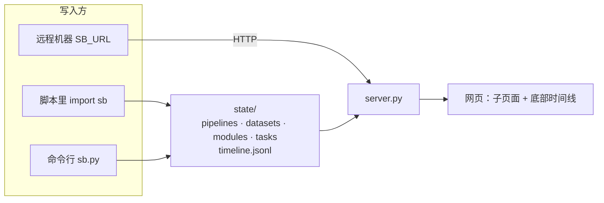

# status_board

通用、可移植的状态看板：**Pipeline 结构图（节点带中文作用标注）**、**数据管理图（多地址 + 来源/用处/处理情况）**、**进程记录（训练 / 流水线执行 / 评测）**、**定制展示模块**，并用**时间线**回放变化过程（以动画过渡而非直接切换）。

只依赖 Python 3.8+ 标准库，前端无 CDN、无构建步骤，整个目录拷走即可用。

```bash
python3 server.py                  # http://127.0.0.1:8765
python3 server.py --host 0.0.0.0 --port 8765    # 对外监听前必须先 export SB_TOKEN=xxx，否则写接口关闭
```

状态全部存放在 `state/`（`SB_STATE_DIR` 或 `--state-dir` 可改），实时模式每 2.5 秒轮询刷新。**新 clone 下来 `state/` 是空的**——看板上没有任何内容，直到你写入定义和任务；想先看效果，见下面的「范例」。



## 页面结构（子页面嵌套，米黄色基调）

用 URL hash 做多级子页面，带面包屑，可分享链接、浏览器前进后退可用：

| 地址 | 内容 |
|---|---|
| `#/` | 首页：六类入口、正在运行的任务、需要关注（失败/停滞/数据缺失/副本不一致）、最近里程碑 |
| `#/train` → `#/task/<id>` | 训练列表 → 详情：模型、使用的数据（含地址、用量）、超参数、训练曲线、指标 |
| `#/run` → `#/task/<id>` | 流水线执行：每个步骤上的数据要素数、「要素 × 步骤」矩阵 |
| `#/eval` → `#/task/<id>` | 评测：评测集及其地址、被测模型、进度与分数 |
| `#/pipelines` → `#/pipelines/<图>` → `#/pipelines/<图>/<步骤>` | 结构图（节点标注「作用」）→ 单个步骤子页面（输入输出、读写的数据、关联任务、上一步/下一步） |
| `#/datasets` → `#/datasets/<图>` → `#/datasets/<图>/<资产>` | 数据血缘图 + 清单 → 单份数据：**所有存放地址（含备份，自动校验副本一致性）**、含义、来源、用处、被处理情况 |
| `#/modules` → `#/modules/<id>` | 指标卡、柱状/折线图、表格、图片/音视频、jsonl 样本抽查、并排对比等 |
| 底部时间线（全局） | 拖动 / 播放(0.5x–8x) / 上一个下一个 / 仅看关键事件 / 里程碑旗标；回放时节点平移、连线形变、进度条增长、曲线延伸、元素淡入淡出；回放中可继续点进子页面 |

## 快速使用

```python
import sb   # 本目录加入 sys.path，或直接拷贝 sb.py + sbstore.py

sb.define("pipelines", "main", "main.json")        # 写 Pipeline 结构图（字段见 skills/status-board/references/schema.md）
sb.define("datasets", "main", "data.json")         # 写数据管理图
sb.task("train1", kind="train", name="微调", pipeline="main", node="train",
        model={"name": "base-7b"}, datasets=[{"name": "训练集", "ref": "main/clean", "role": "训练集"}],
        status="running", done=10, total=1000, unit="step")
sb.point("train1", "loss", 10, 2.31)               # 曲线
sb.item("run1", "sample-01", step="clean", status="running")   # 流水线中的某个要素走到了哪步
sb.milestone("v2 清洗规则升级", note="…")            # 时间线旗标
```

```bash
python3 sb.py show        # 当前状态概览
python3 sb.py validate    # 体检：定义是否完整、引用是否有效
python3 sb.py -h          # 全部命令
```

远程机器上报：设 `SB_URL=http://host:port`（可选 `SB_TOKEN`），同样的代码自动改走 HTTP。

## 范例

`examples/` 里有四个**形状各异**的范例（线性链、扇入+关卡+扇出、并行支线、带人工关卡的纯步骤流），内容全是虚构的，只用来对照字段写法，**不是模板**。

```bash
python3 examples/play.py                                     # 把四个范例模拟运行到一块临时看板（约 10 秒，只写 examples/.play/）
python3 server.py --state-dir examples/.play/all --port 8766
```

范例带 `_example` 标记并统一用 `/example/` 占位路径：页面上会打「范例」标签，抄进真实 `state/` 后 `sb.py validate` 会报警。详见 [`examples/README.md`](examples/README.md)。

## 给 AI 用

仓库自带 skill：`skills/status-board/`（`SKILL.md` + `references/schema.md` 字段格式 + `references/patterns.md` 流程形状与建模模式，流程类内容都用图表示），`.codebuddy/skills/status-board` 是指向它的软链，所以 clone 仓库后在仓库内工作的 AI 会直接发现它。想让其他项目里的 AI 也能用：`cp -r skills/status-board ~/.codebuddy/skills/`。AI 读完就知道怎么记录训练、评测、流水线执行、数据资产和里程碑，写完如何 `validate`，以及**怎么用范例而不被带偏**。

## 时间线是怎么来的

所有变更追加写入 `state/timeline.jsonl`（只追加的事件日志，每个事件带变更后的完整对象）。回放某个时刻 = 把事件折叠到该点。
自动记录：新增/修改/删除定义、任务状态变化与节流后的进度（同一任务每 60 秒最多一条，`SB_EVENT_GAP` 可调）、节点更新、里程碑。手工改 JSON 定义也会被服务补记。

## 安全说明

- 默认只监听 127.0.0.1，并校验 `Host`（防 DNS rebinding），非本机访问需 `SB_ALLOWED_HOSTS=name1,name2`。
- 写接口要求 `Content-Type: application/json`，带 `Origin` 时必须与 `Host` 一致（防跨站）；设置了 `SB_TOKEN` 则需 `Authorization: Bearer`。对外监听且未设 `SB_TOKEN` 时写接口整体关闭，页面也不返回数据真实路径。
- 写入字段白名单 + 长度/类型/数量校验；定义文件限制嵌套深度与大小。
- 资源目录（`/assets/`）只服务白名单扩展名的图片/音视频，解析真实路径后必须仍在资源目录内（防 `..`、软链逃逸）；`.jsonl` 只能通过 `samples` 块读取。
- 页面所有文本经 `textContent` 渲染，不使用 `innerHTML`；令牌只走环境变量。

## 目录

```
server.py    HTTP 服务 + 状态汇总 + 时间线回放     sb.py     上报库 / 命令行
sbstore.py   存储层：校验、原子写、事件日志、体检   static/   前端（ES 模块：util graph views pages timeline app）
state/       真实数据：board.json pipelines/ datasets/ modules/ tasks/ assets/ timeline.jsonl（新 clone 为空）
examples/    范例（虚构内容）+ play.py 播放器；播放结果写在 examples/.play/（已忽略）
skills/status-board/              给 AI 的使用说明（.codebuddy/skills/ 下有软链）
```
