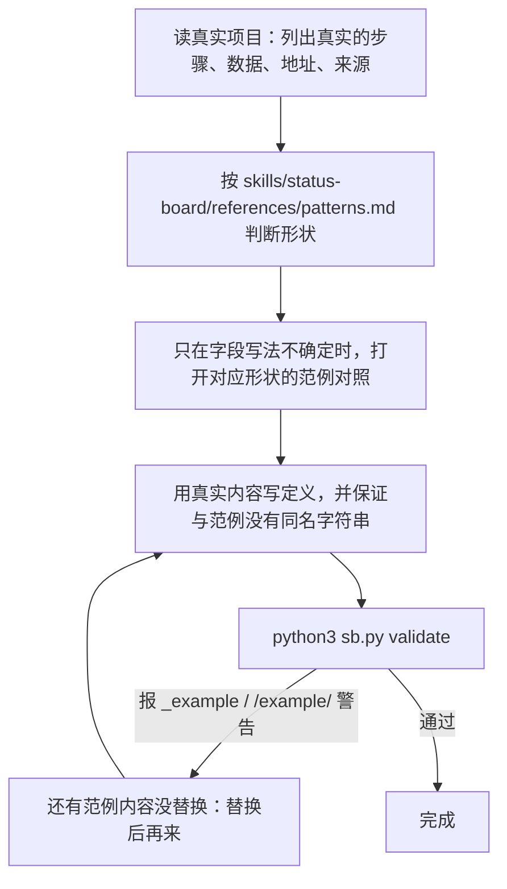
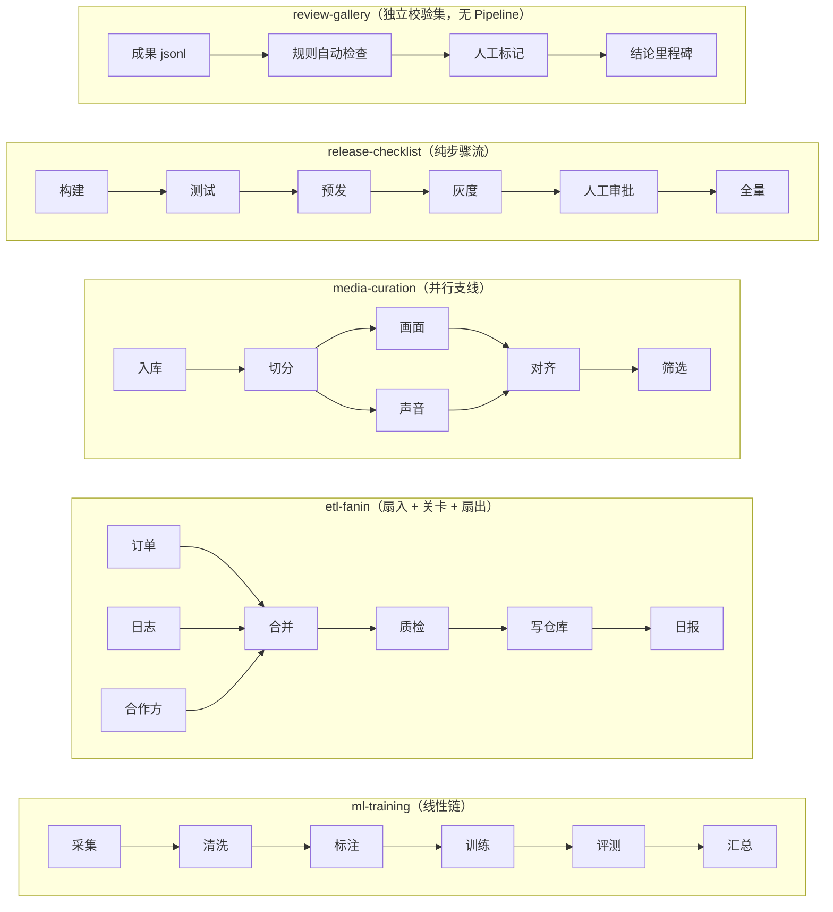

# examples：范例（只示意「形状」，内容全是虚构的）

这里的范例是为了让你看清字段怎么写、页面会是什么样。**它们不是模板。**
照着范例抄名字、数字、路径、步骤，会让真实项目的看板变成「长得像范例」的假记录，比没有记录还糟。

## 怎么用范例



## 五个范例，故意长得不一样

| 范例 | 流程形状 | 领域 | 重点演示 | 刻意**没有**的东西 |
|---|---|---|---|---|
| `ml-training` | 线性链 + 分组 | 模型训练评测 | 训练曲线、数据用量、评测分数、`items` 与 `step_counts` 两种要素上报 | 分叉与汇合 |
| `etl-fanin` | 扇入 → 关卡 → 扇出 | 每日数据 ETL | 并行任务、分片进度、**数据多副本地址**、失败后改规则重跑 | 模型、曲线 |
| `media-curation` | 并行支线再汇合 | 视频素材整理 | 并行支线上的要素追踪（要素 × 支线）、被拒记录 | 评测分数 |
| `release-checklist` | 带人工关卡的纯步骤流 | 服务发布 | 没有数据图也成立；`sb.node` 手工置位；等待人工 | 数据图 |
| `review-gallery` | 无 Pipeline 的独立校验集 | 文本清洗 / 模型回答抽检 | 成果校验：`diff` 前后对比、规则自动抓问题、图片字段、人工标记与改判 | Pipeline、任务 |



## 看效果

```bash
python3 examples/play.py                                   # 把五个范例播放到同一块临时看板（约 10 秒）
python3 server.py --state-dir examples/.play/all --port <端口>
SB_STATE_DIR=examples/.play/all python3 sb.py validate --ignore-example   # 范例自身应体检通过
```

- 播放只写 `examples/.play/`（已 `.gitignore`），**拒绝写入真实的 `state/`**，也拒绝写入非空目录。
- 页面上范例会带「范例」标签，拖动底部时间线可以回放它们的演变。
- **`review-gallery` 的 `scenario.py` 里用 `sb.mark` 模拟了人工标记**，只是为了让页面有内容可看。真实使用中，人工标记应由人在页面上看过之后再标——AI 批量替人标「合格」会让「合格率」失真。

## 防止被范例带偏的几道护栏

1. **形状多样**：五个范例拓扑、领域、上报手法都不同，没有哪一个能当「唯一正确答案」。
2. **占位路径统一用 `/example/`**，定义里带 `_example` 标记：把范例原样抄进真实 `state/`，`validate` 会报警，页面也会打上「范例」标签。
3. **范例里每个节点都只回答它自己的故事**：数字、阈值、版本号全是编的，不要当作默认值。
4. **范例会故意展示不完美的一面**（失败、被拒、跳过、重试），这是在示范记法，不是在暗示你的流程也该这样。

## 目录约定

```
examples/<名字>/
  pipelines.<id>.json   modules.<id>.json   datasets.<id>.json    文件名 = <集合>.<图id>.json
  scenario.py                                                      模拟运行：def run(sb, pause)
  assets/                                                          可选，模块引用的图片/jsonl（播放时复制到临时目录）
```

新增范例：建目录 → 写以上文件 → 在 `play.py` 的 `EXAMPLES` 里登记 → 播放并用 `--ignore-example` 体检。
新范例要和现有的**拓扑或手法至少有一项不同**，否则不值得加。
