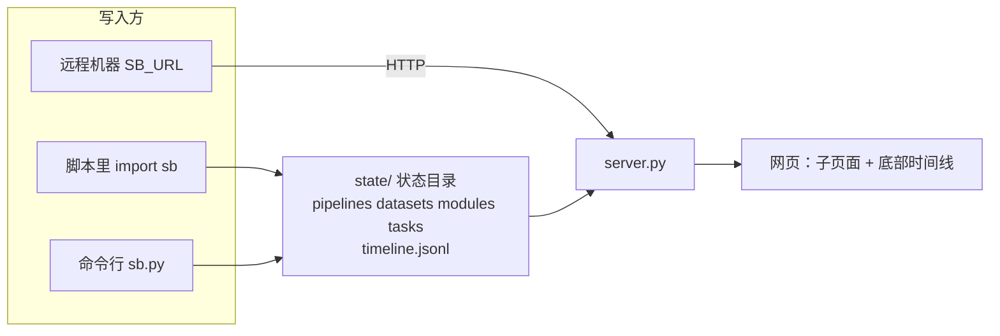
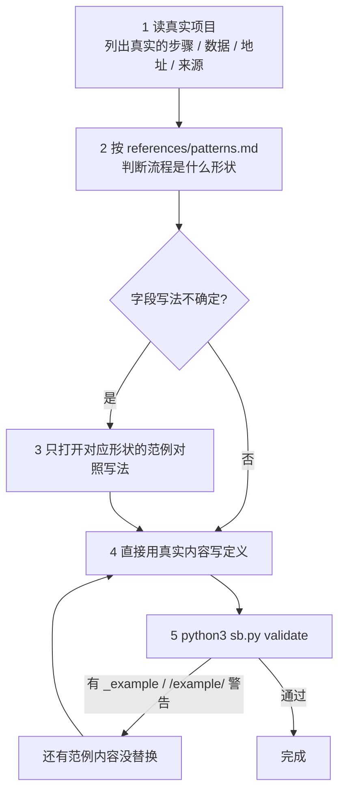
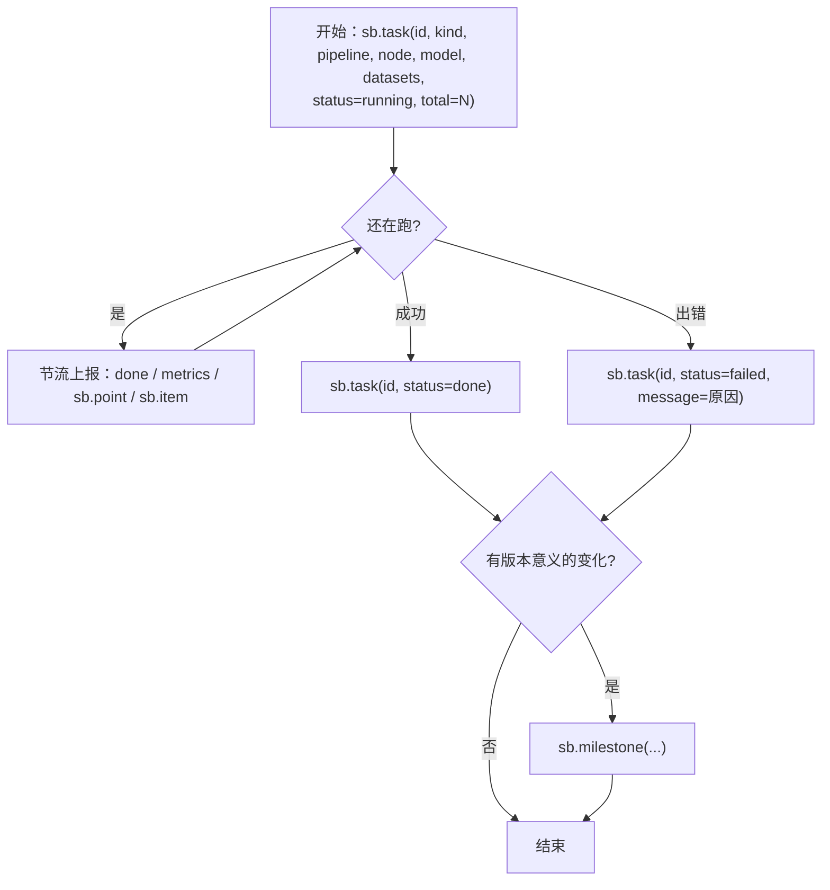
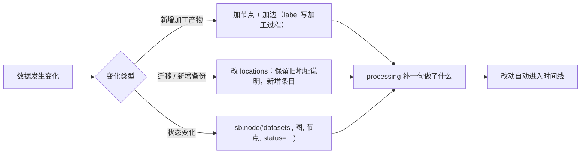
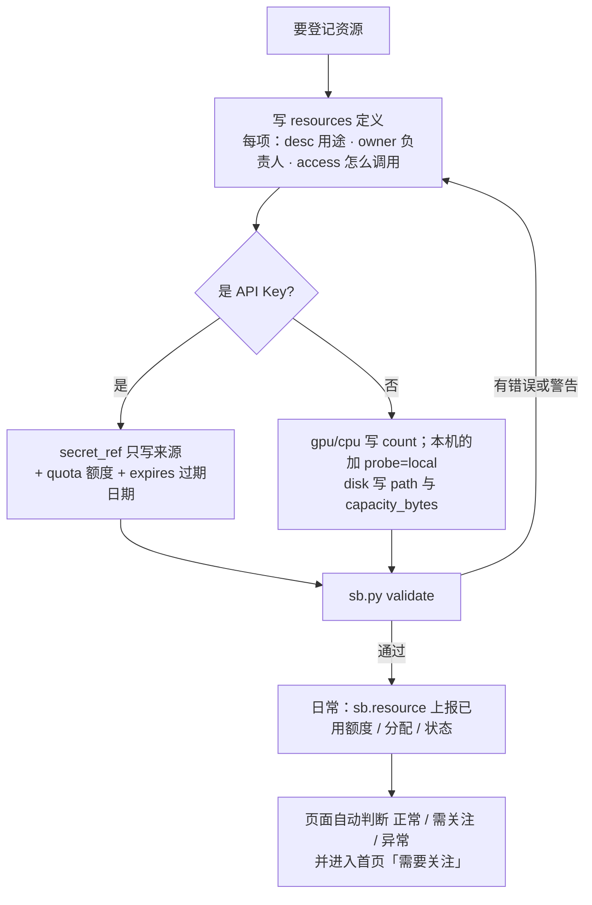
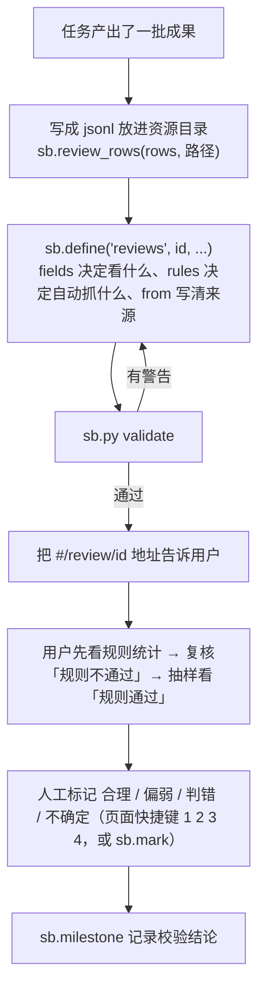
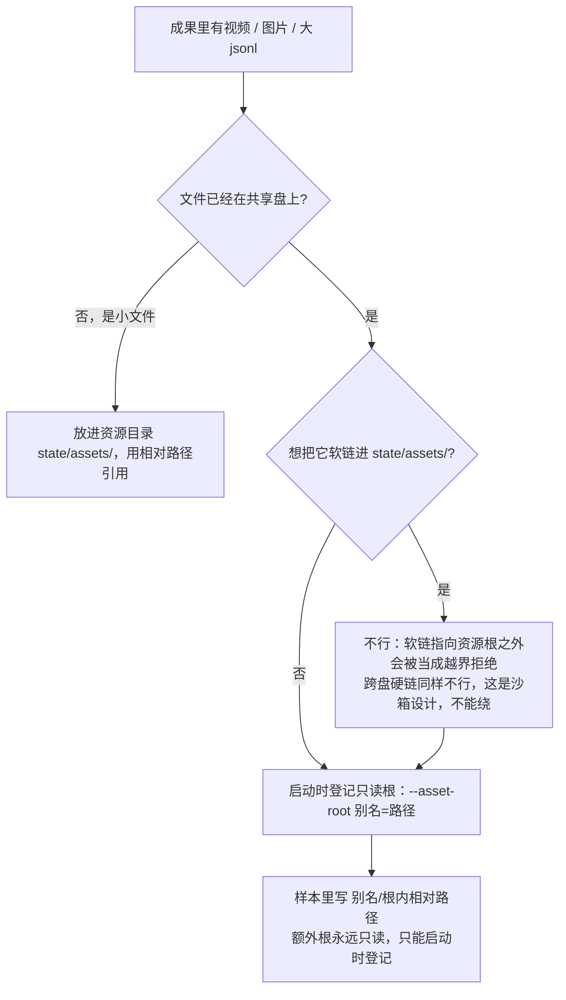
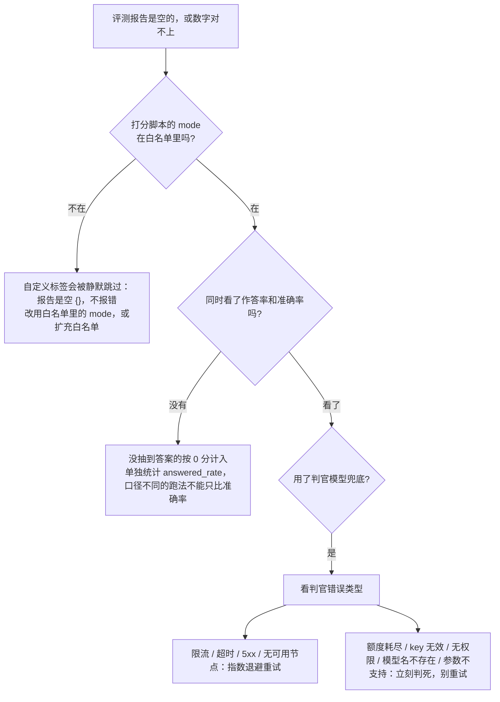
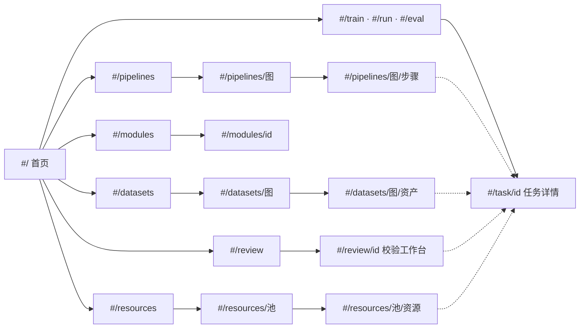

# status-board

`status_board` 是只依赖 Python 标准库的看板：AI 或脚本把「做了什么、跑到哪了、数据在哪」写进状态目录，网页自动显示，并可在时间线上动画回放。仓库根目录就是看板本体。



## 核心原则

1. **边做边记，不要事后补。** 开始任务就上报 `running`，结束置 `done` / `failed`；用户靠看板了解进展，没记录等于没做。
2. **内容只能来自真实项目。** 步骤、数据、地址、数字、阈值都以项目事实为准；不知道就不填，不要编。**不要从范例里取任何内容**（见下面「范例怎么用」）。
3. **只通过 `sb`（库或命令行）写状态**，不手改 `state/tasks/`、`state/timeline.jsonl`。定义文件可用 `sb.define` 或直接改 JSON，服务会自动补记到时间线。
4. **写完必须体检**：`python3 sb.py validate`，目标 0 错误 0 警告。
5. **上报失败不能拖垮业务**：看板没起不影响主任务（`sb.track` 自带保护；自己调用时外层包 try）。
6. **不把令牌 / 密钥写进任何定义、任务、note、message、指标——任何地方都不行。** 要登记 API Key，只写它「从哪取」（`secret_ref`：环境变量名 / 文件路径 / 密钥库条目名）。看板会拒绝或隐去疑似密钥，但检测基于已知格式、不是万能的，不要依赖它兜底。
7. **字段被接受不等于生效。** 数据图 / 展示模块的定义对未知字段**不报错**，校验集对不认识的字段也只是忽略：字段名或层级写错了，页面可能毫无变化、也没有报错。写完要到页面上确认真的显示出来；扩展字段的写法见下面「校验与展示的扩展能力」。

## 范例怎么用（重点：别被范例带偏）

`examples/` 里有六个范例，**拓扑、领域、上报手法都不同，内容全是虚构的**。它们回答的是「这个字段怎么写」，不回答「你的项目长什么样」。



**该学的 / 不该抄的**

| 可以从范例学 | 不可以从范例抄 |
|---|---|
| 字段名、结构、层级怎么写 | 标题、步骤名、节点 id、数据名 |
| 一种形状怎么记录（扇入、并行支线、关卡…） | 节点数量、连线的具体走向（你的流程有几步就画几步） |
| 失败/重试/跳过该如何表达 | 数字：条数、大小、阈值、版本号、进度 |
| 副本地址写几条、`role` 怎么选 | 路径、存储名（`/example/…` 是占位，抄了 `validate` 会报警） |

**自检**：写完后问自己两句——① 把定义里的名字全换成别的，结构还对吗？（对 = 学的是形状）② 有没有哪个步骤是「因为范例里有」才写的？（有 = 删掉）

> 范例里**有意展示了不完美**（失败、被拒、跳过、重试），是在示范记法，不代表你的流程也该有。看效果：`python3 examples/play.py` 然后 `python3 server.py --state-dir examples/.play/all --port <端口>`。详见 `examples/README.md`。

## 上手

```bash
cd <仓库根>
curl -s localhost:<端口>/healthz || python3 server.py --port <空闲端口>     # 已经有人在跑就别重复启动
python3 sb.py show        # 当前有哪些 Pipeline / 数据图 / 任务
python3 sb.py validate    # 体检
```

```python
import sys; sys.path.insert(0, "<仓库根>"); import sb
```

远程上报：`export SB_URL=http://host:port`（可选 `SB_TOKEN`），同样的代码改走 HTTP。`validate` 只能在状态目录所在机器跑。

## 记什么 → 怎么记

| 要记录的事 | 做法 | 字段详见 |
|---|---|---|
| 流程每一步是什么、起什么作用 | `sb.define("pipelines", id, {...})`；每个节点写 `role`（一句话作用，直接显示在图上）+ `desc` | `references/schema.md` §1 |
| 每份数据：在哪、什么意义 | `sb.define("datasets", id, {...})`：`locations`（**有几个副本写几条**）+ `source` + `purpose` + `processing` | §2 |
| 模型训练 | `sb.task(id, kind="train", model=…, datasets=[…], hparams=…)` + `sb.point(id, "loss", step, v)` | §3 |
| 流程执行（每个数据要素到哪一步） | `sb.task(id, kind="run", pipeline=…)` + `sb.item(id, 要素id, step=节点id, status=…)` | §4 |
| 评测 | `sb.task(id, kind="eval", model=…, datasets=[评测集+地址], scores={…})` | §5 |
| 迭代/版本节点 | `sb.milestone("标题", note="…")` | §6 |
| 数据集展示、效果展示 | `sb.define("modules", id, {"blocks": […]})` | §7 |
| 登记可调用的资源：API Key、GPU / CPU、磁盘、对内服务 | `sb.define("resources", id, {items:[…]})`（**密钥只写 secret_ref**）；动态信息 `sb.resource(池, 资源, used=…, allocations=[…])` | §7c、`patterns.md` P13 |
| 逐条审阅一批成果（模型生成的结果、清洗出来的数据） | `sb.review_rows(rows, "x.jsonl")` + `sb.define("reviews", id, {source, fields, rules, from…})`；人工标记 `sb.mark(id, 行号, "pass/weak/fail/doubt")` | §7b、`patterns.md` P12 |

## 标准工作流

**A. 接手新项目：先建「地图」**


**B. 跑任务：边跑边记**



带上 `pipeline` + `node`，图上对应节点会自动联动；长循环用 `for x in sb.track(it, id, …)` 自动收尾。

**C. 数据变了（新增 / 迁移 / 加工 / 备份）**



不要把旧信息直接抹掉而不留 `processing` 说明。

**D. 做效果展示 / 数据集展示** → 写 `modules` 定义（`references/schema.md` §7）；图片、音视频、jsonl 放资源目录（默认 `state/assets/`，`SB_ASSETS_DIR` 可改），用相对路径引用。

**F. 登记 / 维护资源**（API Key、GPU、磁盘……）



- 额度快用完、Key 快过期、磁盘快满、分配超额，都会**自动**出现在首页，不需要另外上报。
- 资源停用：把 `state` 置为 `revoked` / `disabled`（留痕），不要直接删。
- **遇到 `validate` 或写入报「疑似密钥」**：说明某处出现了密钥内容。先去源头删掉，并告诉用户这把密钥可能已经暴露、建议轮换。**不要尝试绕过检测。**
- 看板不会主动连接远程地址探测别的机器；别的机器的用量请在那台机器上用 `sb.resource` 上报。

**E. 校验一批成果**（模型生成的结果 / 清洗出来的数据）



- **description 里写清判定标准**——"怎样算合格"是人工标记的依据，也是下一个人接手时的依据。
- 规则只负责把注意力引到可疑样本上；语义对不对这类判断交给人工，不要硬写成规则。
- **不要替用户做人工标记**：`sb.mark` 是给「用户明确交代了判定方法」的场景（例如按某规则批量标记）用的；默认由用户在页面上看了再标。

## 校验与展示的扩展能力

这些能力来自真实使用，已在 `main` 上。**想用哪个，直接按对应章节写字段**：

| 想做的事 | 需要的字段 | 字段文档 |
|---|---|---|
| 数据资产几十份，关系图看不清 | 数据图 `groups` + 每个节点 `brief`；更多用 `layout: "list"` | `references/schema.md` §2 |
| 成果几千行以上，想按字段切着看 | 校验集 `facets`（≤6 个）+ `matrix:{rows,cols,metric}` | §7b-2 |
| 视频 / 图片已在共享盘，不想复制 | 启动参数 `--asset-root 别名=路径`，样本写 `别名/相对路径` | §7b |
| 校验页要两级分组浏览 | 校验集 `group_by`（≤2 级，每级 `{key,label,catalog}`）、`summary`（≤4 个字段名） | `sbstore.py` 的 `_check_review`（schema 暂无专门章节） |
| 一行一条视频的成果，要图库视图 | 校验集 `gallery` 块 | §7b-3 |
| 论文用的转移矩阵热力图 / 状态流转图（环形 / 枢纽图用 `layout: "free"`） | 展示模块块 `heatmap`、`flow`；Pipeline 节点也可带 `blocks` 在步骤详情里内嵌图 | §7 |

- 人工标记是**四档**：`pass` 合理 / `weak` 偏弱 / `fail` 判错 / `doubt` 不确定。校验页和图库的键位一致：`1` `2` `3` `4`，`N` 写备注。
- 同一个校验集可以同时配 `gallery`、`facets` / `matrix`、`group_by`。
- 写完用 `sb.py validate` 体检，再**打开页面确认真的显示出来**（原则 7）。

## 实践经验（来自真实使用）

**大文件放哪：别软链、别复制**



- 一行一条视频的 jsonl，单行常有几百 KB。单行默认上限 200KB，超过会被跳过并计为「超长行」；整份都要看就设 `SB_REVIEW_LINE_MAX=2000000`。
- 统计目录大小**不要用 `du`**：共享盘（ceph 的 dop-fuse）上目录项会报虚高尺寸。改用逐文件求和：`find <目录> -type f -printf "%s\n" | awk '{s+=$1} END{print s}'`。数据节点的 `auto_stat` 已经是逐文件累加，不受影响。

**评测结果为空 / 对不上，按这个顺序查**



- 不同跑法（自然提问、追加作答格式、完整前后台链路）**口径不同**，横向比较要同时记录作答率与准确率：上报时两者都放进 `scores`，例如 `scores={"accuracy": …, "作答率": …}`。
- 驱动脚本若有后台异步任务，**必须等后台任务进入终态再关会话**，否则结果注入不进去，表现为前台说「交给后台处理」然后没下文。
- 同机并行跑多个服务实例：端口、GPU、运行目录、工作目录各自隔离。

**校验集的使用习惯**

- 成果多时先看分布再抽样：有 `facets` / `matrix` 就先看矩阵，哪一格偏弱再点进去。矩阵始终展示全量、不随筛选收缩；点格子等于同时按行、列两个分面筛选。
- 人工标记是四档 `pass / weak / fail / doubt`（合理 / 偏弱 / 判错 / 不确定），`weak` 表示「不算错但质量偏弱」。
- 数据图节点的 `brief` 是显示在图上的一句话，`desc` 才是完整的「含义」，两者不要混用。

## 页面是子页面嵌套的

汇报时直接给链接比口头描述有用：`http://<host>:<port>/#/task/<id>`。



## 常见坑

- `id` 只能含字母数字 `_ . -`，≤64 字符；节点引用格式 `"<图id>/<节点id>"`。
- 要素很多（>200）时不要逐个 `sb.item`，改传 `step_counts`（**整体替换**，每次传完整快照）；怎么选见 `references/patterns.md` P10。
- 并行支线上的要素：把「要素 × 支线」各当一个要素（P4）。图里**不能有环**，「重试」的表达方式见 P6。
- 同一任务的普通进度每 60 秒才写入时间线一次（状态变化必写）；调试可设 `SB_EVENT_GAP=1`。
- `running` 超过 `stale_after`（默认 300s）无上报会标「疑似停滞」；长耗时步骤要设大 `stale_after` 或定时心跳。
- 曲线每条最多 300 点（自动抽稀）；`datasets` 列表是**整体替换**（更新用量要传完整列表）。
- 对外监听（`--host 0.0.0.0`）时，数据 `path` 默认不返回给浏览器，写接口需要 `SB_TOKEN`。
- 资源池里的 `used_by` / 分配可以链接到任务；`replica_of` 表示备份关系，`auth_ref` 表示服务用哪把 Key。
- 校验集的 `source` 必须在资源目录内、以 `.jsonl` 结尾；规则**没有正则**，只有声明式 op（见 §7b 表）；回放历史时看不到样本明细。
- 软链指向资源目录以外会被当成越界拒绝；大文件在共享盘上请用 `--asset-root`（见「实践经验」），不要复制也不要软链。
- 启动服务和使用扩展功能会产生 `.sb_token`、`server.log`、`server.pid`、`state/assets/`，`.gitignore` 已覆盖，不要手动 `git add -f`。
- 扩展字段（`layout` / `facets` / `gallery` / `heatmap`…）写错层级不会报错也不会生效，见原则 7。

## 修改看板本身时

改 `static/*.js` 后至少检查：括号配平、`import/export` 名字一致；**一定要实际渲染一次**——ES 模块里 `const` 先用后声明这类错误只有打开页面才暴露，语法检查抓不到（出过一个：`drawGraph` 里 `nodes` 先用后声明，整页数据图渲染报错）。`tests/test_static.mjs` 把 `util.js` / `store.js` 换成最小桩直接跑 `drawGraph`（需要 Node 18+）；`python3 tests/test_status_board.py` 和 `python3 tests/test_asset_roots_http.py` 不需要 Node，改后端也请跑。渲染文本一律经 `h()`/`s()`（`textContent`），**不要用 `innerHTML`**。动画依赖 `util.js` 的 `patch`（增量合并 + `data-key`），新增视图元素要给稳定的 `data-key`。

前端分层：`util.js`（DOM / patch / 格式化）→ `graph.js`（布局与结构图）→ `views.js`（任务卡、节点详情、模块块；热力图 / 流转图在 `transition.js`）→ `review.js`（校验工作台）/ `gallery.js`（视频图库）/ `resources.js`（资源管理）→ `pages.js`（路由与各子页面）→ `app.js`（取数、顶栏、轮询）。新增子页面：在 `pages.js` 的 `parseRoute` 加路由、写页面函数、在 `renderPage` 分发。配色全部是 `style.css` 顶部的 CSS 变量（米黄基调），JS 里不写死颜色。

> 本 skill 的唯一副本在 `skills/status-board/`；`.codebuddy/skills/status-board` 是指向它的软链。
