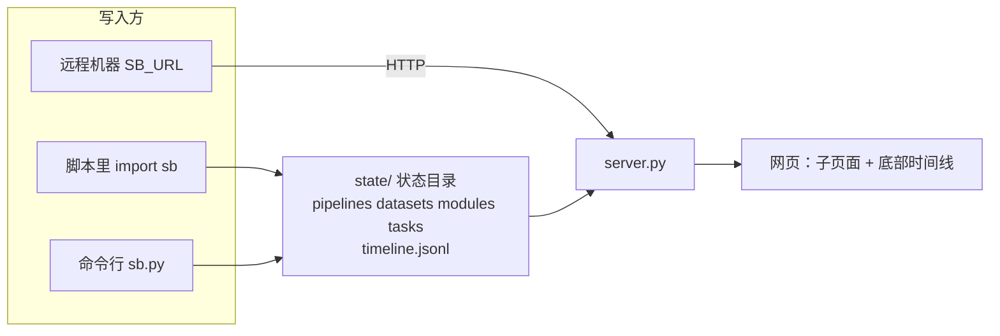
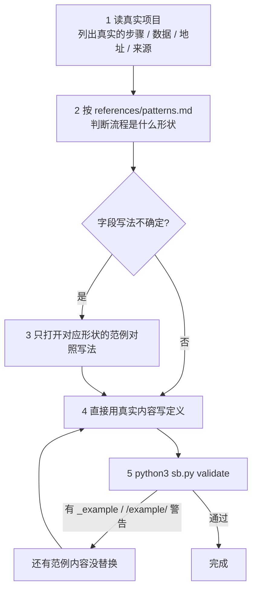
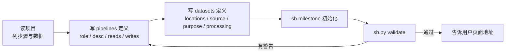
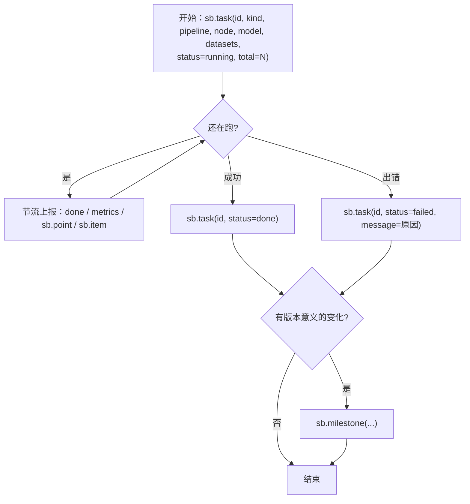
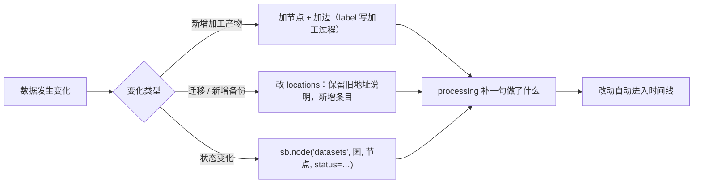
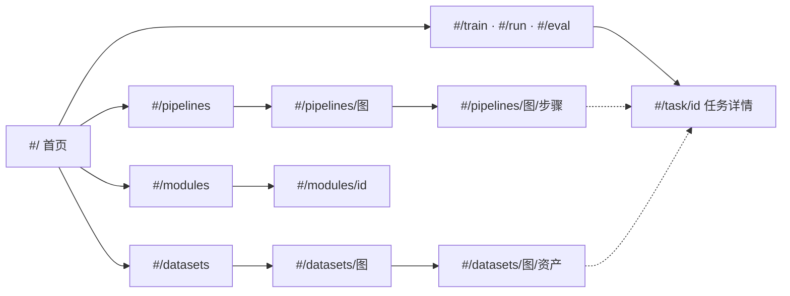

# status-board

`status_board` 是只依赖 Python 标准库的看板：AI 或脚本把「做了什么、跑到哪了、数据在哪」写进状态目录，网页自动显示，并可在时间线上动画回放。仓库根目录就是看板本体。



## 核心原则

1. **边做边记，不要事后补。** 开始任务就上报 `running`，结束置 `done` / `failed`；用户靠看板了解进展，没记录等于没做。
2. **内容只能来自真实项目。** 步骤、数据、地址、数字、阈值都以项目事实为准；不知道就不填，不要编。**不要从范例里取任何内容**（见下面「范例怎么用」）。
3. **只通过 `sb`（库或命令行）写状态**，不手改 `state/tasks/`、`state/timeline.jsonl`。定义文件可用 `sb.define` 或直接改 JSON，服务会自动补记到时间线。
4. **写完必须体检**：`python3 sb.py validate`，目标 0 错误 0 警告。
5. **上报失败不能拖垮业务**：看板没起不影响主任务（`sb.track` 自带保护；自己调用时外层包 try）。
6. 不把令牌/密钥写进任何定义、任务或 note。

## 范例怎么用（重点：别被范例带偏）

`examples/` 里有四个范例，**拓扑、领域、上报手法都不同，内容全是虚构的**。它们回答的是「这个字段怎么写」，不回答「你的项目长什么样」。



**该学的 / 不该抄的**

| 可以从范例学 | 不可以从范例抄 |
|---|---|
| 字段名、结构、层级怎么写 | 标题、步骤名、节点 id、数据名 |
| 一种形状怎么记录（扇入、并行支线、关卡…） | 节点数量、连线的具体走向（你的流程有几步就画几步） |
| 失败/重试/跳过该如何表达 | 数字：条数、大小、阈值、版本号、进度 |
| 副本地址写几条、`role` 怎么选 | 路径、存储名（`/example/…` 是占位，抄了 `validate` 会报警） |

**自检**：写完后问自己两句——① 把定义里的名字全换成别的，结构还对吗？（对 = 学的是形状）② 有没有哪个步骤是「因为范例里有」才写的？（有 = 删掉）

> 范例里**有意展示了不完美**（失败、被拒、跳过、重试），是在示范记法，不代表你的流程也该有。看效果：`python3 examples/play.py` 然后 `python3 server.py --state-dir examples/.play/all --port <端口>`。详见 `examples/README.md`。

## 上手

```bash
cd <仓库根>
curl -s localhost:<端口>/healthz || python3 server.py --port <空闲端口>     # 已经有人在跑就别重复启动
python3 sb.py show        # 当前有哪些 Pipeline / 数据图 / 任务
python3 sb.py validate    # 体检
```

```python
import sys; sys.path.insert(0, "<仓库根>"); import sb
```

远程上报：`export SB_URL=http://host:port`（可选 `SB_TOKEN`），同样的代码改走 HTTP。`validate` 只能在状态目录所在机器跑。

## 记什么 → 怎么记

| 要记录的事 | 做法 | 字段详见 |
|---|---|---|
| 流程每一步是什么、起什么作用 | `sb.define("pipelines", id, {...})`；每个节点写 `role`（一句话作用，直接显示在图上）+ `desc` | `references/schema.md` §1 |
| 每份数据：在哪、什么意义 | `sb.define("datasets", id, {...})`：`locations`（**有几个副本写几条**）+ `source` + `purpose` + `processing` | §2 |
| 模型训练 | `sb.task(id, kind="train", model=…, datasets=[…], hparams=…)` + `sb.point(id, "loss", step, v)` | §3 |
| 流程执行（每个数据要素到哪一步） | `sb.task(id, kind="run", pipeline=…)` + `sb.item(id, 要素id, step=节点id, status=…)` | §4 |
| 评测 | `sb.task(id, kind="eval", model=…, datasets=[评测集+地址], scores={…})` | §5 |
| 迭代/版本节点 | `sb.milestone("标题", note="…")` | §6 |
| 数据集展示、效果展示 | `sb.define("modules", id, {"blocks": […]})` | §7 |

## 标准工作流

**A. 接手新项目：先建「地图」**



**B. 跑任务：边跑边记**



带上 `pipeline` + `node`，图上对应节点会自动联动；长循环用 `for x in sb.track(it, id, …)` 自动收尾。

**C. 数据变了（新增 / 迁移 / 加工 / 备份）**



不要把旧信息直接抹掉而不留 `processing` 说明。

**D. 做效果展示 / 数据集展示** → 写 `modules` 定义（`references/schema.md` §7）；图片、音视频、jsonl 放资源目录（默认 `state/assets/`，`SB_ASSETS_DIR` 可改），用相对路径引用。

## 页面是子页面嵌套的

汇报时直接给链接比口头描述有用：`http://<host>:<port>/#/task/<id>`。



## 常见坑

- `id` 只能含字母数字 `_ . -`，≤64 字符；节点引用格式 `"<图id>/<节点id>"`。
- 要素很多（>200）时不要逐个 `sb.item`，改传 `step_counts`（**整体替换**，每次传完整快照）；怎么选见 `references/patterns.md` P10。
- 并行支线上的要素：把「要素 × 支线」各当一个要素（P4）。图里**不能有环**，「重试」的表达方式见 P6。
- 同一任务的普通进度每 60 秒才写入时间线一次（状态变化必写）；调试可设 `SB_EVENT_GAP=1`。
- `running` 超过 `stale_after`（默认 300s）无上报会标「疑似停滞」；长耗时步骤要设大 `stale_after` 或定时心跳。
- 曲线每条最多 300 点（自动抽稀）；`datasets` 列表是**整体替换**（更新用量要传完整列表）。
- 对外监听（`--host 0.0.0.0`）时，数据 `path` 默认不返回给浏览器，写接口需要 `SB_TOKEN`。

## 修改看板本身时

改 `static/*.js` 后至少检查：括号配平、`import/export` 名字一致；渲染文本一律经 `h()`/`s()`（`textContent`），**不要用 `innerHTML`**。动画依赖 `util.js` 的 `patch`（增量合并 + `data-key`），新增视图元素要给稳定的 `data-key`。

前端分层：`util.js`（DOM / patch / 格式化）→ `graph.js`（布局与结构图）→ `views.js`（任务卡、节点详情、模块块）→ `pages.js`（路由与各子页面）→ `app.js`（取数、顶栏、轮询）。新增子页面：在 `pages.js` 的 `parseRoute` 加路由、写页面函数、在 `renderPage` 分发。配色全部是 `style.css` 顶部的 CSS 变量（米黄基调），JS 里不写死颜色。

> 本 skill 的唯一副本在 `skills/status-board/`；`.codebuddy/skills/status-board` 是指向它的软链。
