# 拓扑与建模模式（抽象版，故意不含任何业务内容）

这里只画「形状」，节点名都是占位（步骤 1、数据 A …）。真实内容必须来自你面对的项目。
需要看某个字段的具体写法时，再去 `examples/` 找对应形状的范例。

**建模顺序**：先读 P0（怎么设计一张好读的图），再按形状选 P1–P6，数据与要素看 P8–P10（数据有多个版本看 P8b），其余按需。

## P0 Pipeline 设计策略（先读这一节，再选形状）

P1–P13 讲「形状长什么样」，这一节讲**怎么把一个真实流程设计成一张好读的图**。下面每条约束都对照过渲染代码或体检规则，并标了「体检会不会抓」。

### 设计顺序

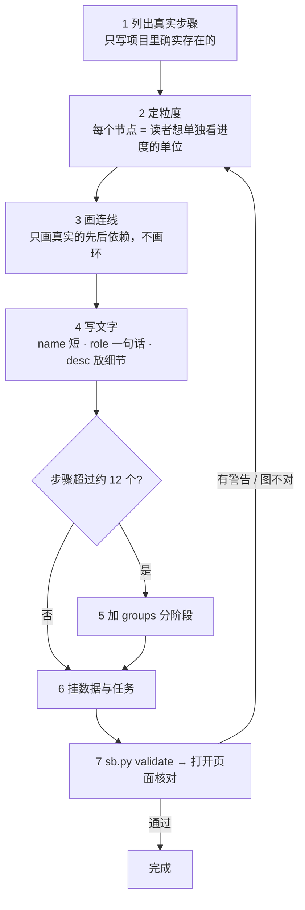

### 1. 节点粒度：以「读者想单独看进度」为单位

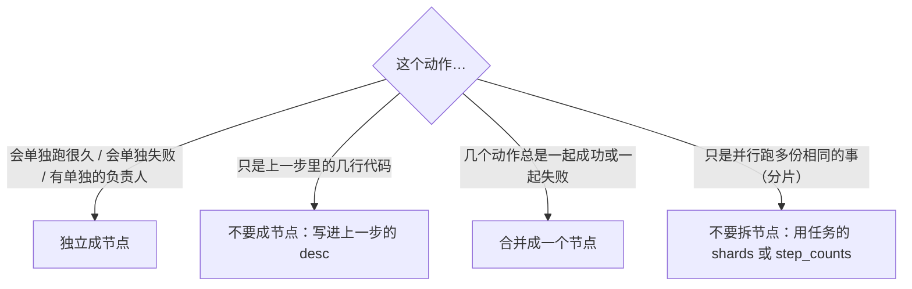

- **推荐 5–12 个节点**。一张图的结构图是「一眼看全貌」用的；超过约 12 个就用 `groups` 分阶段，而不是继续往下排。
- **反例一：把函数调用栈画成流程。** 「读文件 → 解码 → 校验 → 写文件」如果是同一个脚本里连着跑的，画成一个节点「入库」，细节写进 `desc`。
- **反例二：为每个分片画一个节点。** 100 个分片是 100 份相同的事，不是 100 个步骤。用任务的 `shards`（进度）或 `step_counts`（要素分布）表达，见 P10。
- **反例三：把「等待」画成节点。** 排队、等审批如果值得单独看，才画成节点（`kind="gate"`，见 P5）；否则写进相邻步骤的 `note`。
- 节点上限：**300 个**（超过写不进去，服务端拒绝）。实际远用不到。

### 2. 连线：只画真实的先后依赖

- 一条边 = 「B 必须等 A 做完才能开始」。**没有依赖就不要连**，哪怕两步在时间上是先后发生的。
- **图里不能有环**，`validate` 会报**错误**（`存在环，无法分层布局`）。「失败了重试」「迭代多轮」的表达方式见 P6，不要用回边。
- **孤立节点**（没有任何连线）体检会**警告**。真有独立的一步，也要和流程里的某处连上，否则读者不知道它在哪个阶段。
- 边的 `label` 写**传递的东西**（「清洗后的样本」），不是动作；多数边不需要 label，图上有字太多反而乱。
- 画布是按**最长路径分层**排的：一个节点所在的列 = 它离起点最长的那条路径的长度。所以一条「捷径」边（A 直接连到 D，而 A→B→C→D 也存在）不会让 D 往前挪，只是多一条斜线。图太乱时先检查有没有这种多余的捷径边。

### 3. 文字：显示位置不同，长度上限不同

| 字段 | 显示在 | 上限 | 超出会怎样 | 体检 |
|---|---|---|---|---|
| `name` | 节点标题 | 约 **11 个汉字**（22 单位；英文 22 字符） | 被截断成「……」 | 会警告 |
| `role` | 节点第二行 | 约 **17 个汉字**（34 单位；英文 34 字符） | 被截断 | 会警告 |
| `desc` | 步骤详情页、右侧步骤列表 | 无硬上限 | 完整显示 | 缺失会警告 |
| 边 `label` | 连线中间 | 约 10 个汉字 | 被截断 | 不检查 |

- 长度按**显示宽度**算：汉字等宽字符算 2 个单位，字母数字算 1 个。「一二三…」写 17 个汉字刚好顶格，18 个就截断。
- **role 写「这一步做什么」，不写「怎么做」**。好的：「去重并过滤低质量样本」。差的：「用 MinHash 对文本去重，阈值 0.8，再用规则过滤长度小于 10 的」——细节放 `desc`。
- 没有 `role` 时图上显示「（未填写作用说明）」，体检也会警告。**一个节点的 `role` 和 `desc` 都要写**。
- 页面上看到的完整内容来自 `desc`，所以 `desc` 应该回答三件事：做了什么、规则或边界是什么、出错时怎么办。

### 4. 分组：只用来分阶段，不用来表达依赖

- `groups` 把几个节点用虚线框起来并标上阶段名，适合「数据准备 / 训练 / 评测」这样的**阶段**。
- 分组框是按成员节点的位置取**外接矩形**画的，**不参与布局**。所以：
  - 一个分组里的节点应该**在图上挨着**（连续的几步）。把不相邻的节点放进同一个组，框会变得很大，把无关节点也框进去。
  - **一个节点只属于一个分组**。同属两个组时分组框会重叠、节点详情也只显示其中一个。体检会**警告**，但**服务端不会拒绝**，所以写完一定要 validate。
- `groups[].nodes` 里写了不存在的节点 id 会被**直接拒绝**（写入失败，不是警告）。
- 不属于任何分组的节点照常显示，不必为了「整齐」给每个节点都分组。

### 5. kind：只有 7 个合法值，写错只是显示英文原词

`source`（数据源）· `process`（处理）· `model`（模型）· `train`（训练）· `eval`（评测）· `output`（产出）· `gate`（关卡）

- `kind` 只影响节点第三行显示的类型词，**不影响布局和状态**，可以不写。
- 写成别的词（比如 `banana`）**服务端不拒绝**，图上会原样显示这个英文词。体检会**警告**。

### 6. 让图「活」起来：状态从哪来

图上节点的状态**不用手填**，来自任务，按下表自动汇总：

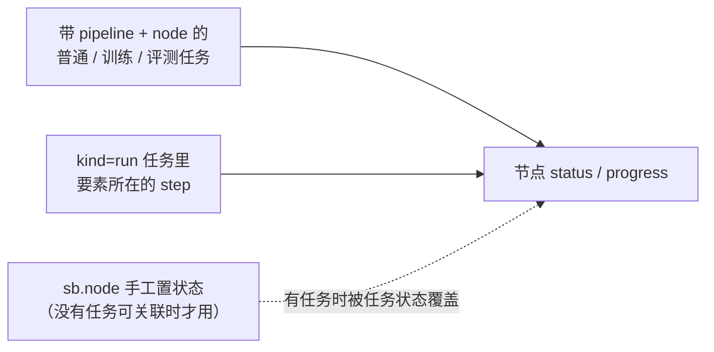

- **推荐做法**：每个会跑的节点至少挂一个任务（`sb.task(..., pipeline=图id, node=节点id)`），节点就自动显示进度条和状态。
- 手工置状态（`sb.node`）只适合**没有任务可挂**的步骤（比如人工审批、外部系统触发）。实测的优先级：
  - 节点**没有**关联任务、也没有要素流过：手工状态**保留**。
  - 节点**有**关联任务：任务状态**覆盖**手工状态（手工置 `running`、任务已 `done` → 显示 `done`）。
  - 有 `kind="run"` 的要素已经流到**下游**：上游节点被推导为「已完成」，**覆盖**手工置的 `skipped`。
- 节点没有任何任务也没有手工状态时，默认显示「待执行」。
- 想让某一步显示「疑似停滞」：给它的任务设 `stale_after`（秒），超过没心跳就标出来。长耗时步骤要把它设大，否则会误报。

### 7. 数据：读什么、写什么要写在节点上

- 节点的 `reads` / `writes` 写成 `"数据图id/节点id"`，页面会在步骤详情里显示链接，并在数据详情里反向显示「被哪个步骤读 / 写」。**两边只需要写一边**。
- 引用不存在的数据节点体检会**警告**，所以先建数据图、再建 Pipeline，或者两个一起写完再 validate。
- 步骤要展示自己内部的结构（比如一棵逻辑树）：节点可以带 `blocks`（格式同展示模块），点进步骤子页面时显示。见 `schema.md` §7。

### 8. 改版与维护

- 流程变了就**直接改定义**，时间线会保留旧版并能回放，不用另存一份。
- 删掉一个节点前，先看有没有任务的 `node` 还指向它——体检会警告「引用的节点不存在」。
- 大改之后用 `sb.milestone("流程改版：…")` 标一下，回放时好找。

### 自检清单（写完 Pipeline 对着看）

| 检查 | 怎么查 |
|---|---|
| 每个节点都是读者想单独看进度的单位，数量 5–12 个 | 数一下；超过就考虑合并或分组 |
| 没有环、没有孤立节点 | `sb.py validate`（环是错误，孤立是警告） |
| `name` ≤ 11 汉字，`role` ≤ 17 汉字 | `sb.py validate`（会警告） |
| 每个节点 `role` 和 `desc` 都有 | `sb.py validate` |
| `kind` 只用 7 个合法值，或不写 | `sb.py validate` |
| 一个节点只属于一个分组，分组里的节点在图上相邻 | validate 抓重复；相邻要**打开页面看** |
| 会跑的节点都挂了任务 | 看页面上节点是否有进度条；全是「待执行」说明没挂 |
| 没有任何内容来自范例 | validate 的 `_example` 警告 |
| **打开页面确认图是你想要的样子** | 体检抓不到「图虽然合法但很难读」 |

---

## 先判断：你的流程属于哪种形状

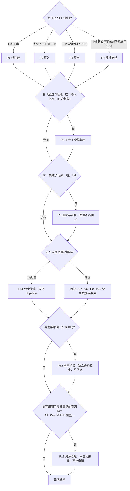

---

## P1 线性链


- 记法：每个节点写 `role`（一句话作用）+ `desc`；边不用写 `label`，除非传递物值得说明。
- 常见误用：把一个步骤拆成十几个小节点。节点是读者想单独看进度/作用的单位，不是函数调用栈。

## P2 扇入（多个来源汇到一处）

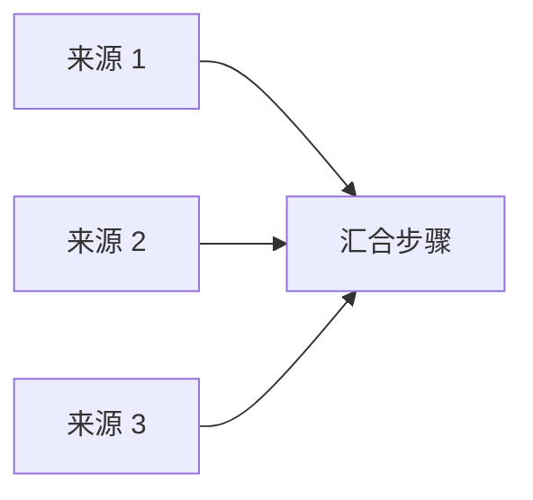

- 记法：每个来源一个节点，各自可挂各自的任务；汇合步骤的 `reads` 列出全部上游数据。
- 一个来源缺失时：让汇合步骤的 `desc` 写清缺失时的处理方式，并在该来源节点的 `note` 里记下这次缺失。
- 注意：若有 `kind="run"` 任务的要素已流经下游，服务会按图的先后关系把上游节点推导为「已完成」，**覆盖** `sb.node` 手工置的 `skipped`。所以缺失要靠 `note` 和任务的 `message` 表达，不要只依赖手工状态。

## P3 扇出（一处分流到多个出口）

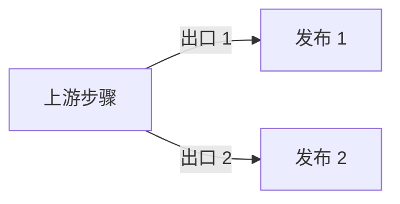

- 记法：边的 `label` 写分流条件或传递物。出口之间若有先后（先 1 后 2），画成链，不要画成扇出。

## P4 并行支线再汇合

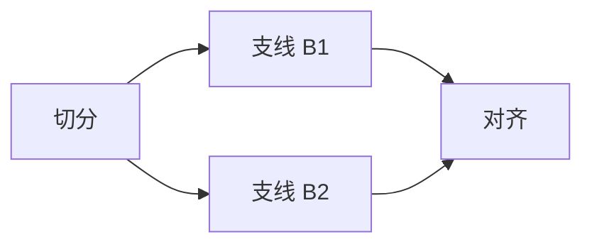

- 要点：一个**要素**同一时刻只位于一个步骤。要追踪「要素在并行支线上的位置」时，把「要素 × 支线」各当一个要素：

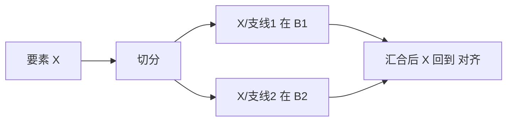

- 「要素 × 步骤」矩阵里，不在某条支线上的格子显示「不经过」，是正确的，不是漏记。

## P5 关卡与旁路输出

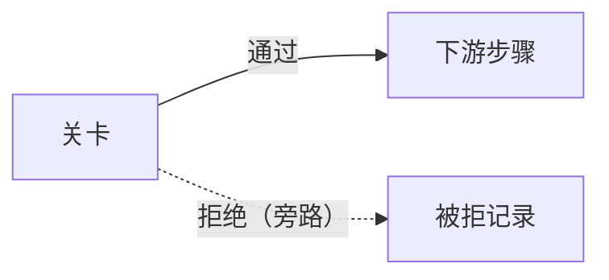

- 记法：关卡节点 `kind="gate"`。被拒的东西**要保存**并作为数据资产记录（`R`），写明拒绝原因去向。
- 人工审批：关卡节点 `status="running"` + `note` 写清「在等谁、等什么」，批准后置 `done`。

## P6 重试与迭代：图里不能画环

`validate` 会把环当成**错误**（布局需要无环）。需要表达「再来一遍」时三选一：

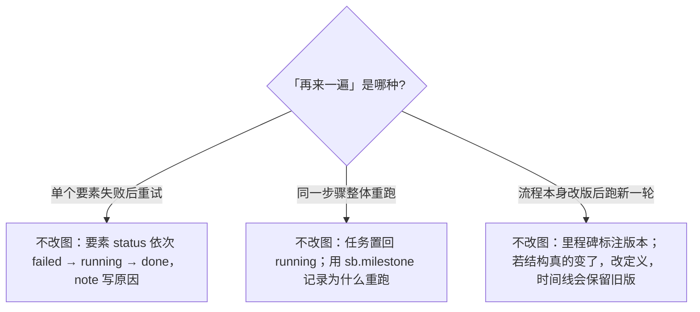

## P8 数据：多个地址（副本）

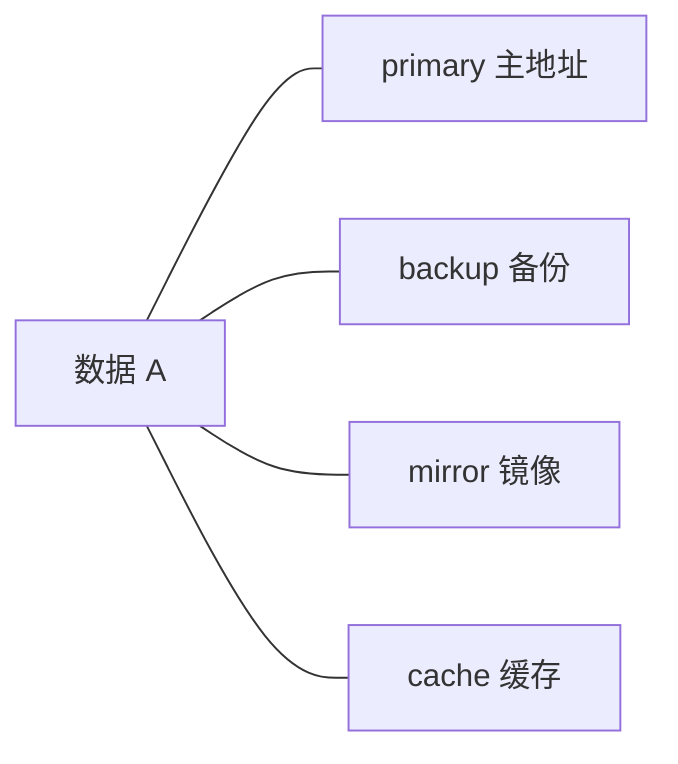

- 记法：`locations` 每个副本一条：`label`、`role`、`storage`、`path`、`note`（同步方式/延迟）。**有几个地址就写几条，不要只写主地址。**
- `role` 取值：`primary backup mirror remote cache`。本机路径加 `auto_stat` 会统计大小并比对副本是否一致。
- 不知道备份在哪就不要写；用 `note` 或 `processing` 注明「备份位置待确认」。

## P8b 数据的多个版本（v1.0 → v2.0 …）：用 family + version 收纳

同一份数据迭代出多个版本时，**每个版本各建一个数据节点**，再用 `family` 把它们归成一份、`version` 标新旧。
清单里这一份数据只显示**最新版一行**，历史版本收在「▸ 历史版本 N 个」按钮后面，点开才展开。

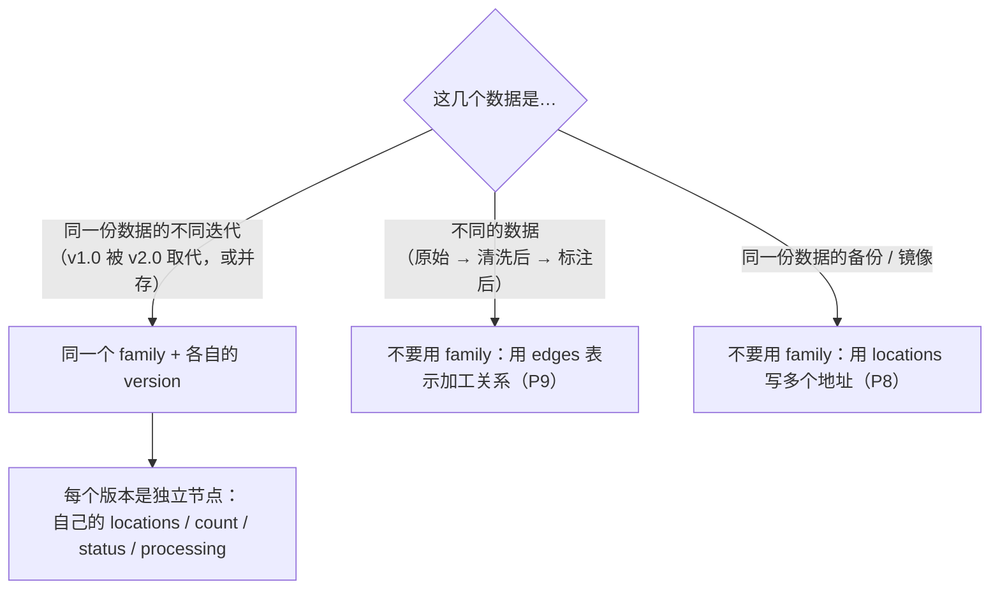

```json
{"nodes": [
  {"id": "clean_v2", "name": "清洗后数据", "family": "ml-clean", "version": "v2.0", "status": "ready",
   "brief": "规则 v2 的清洗结果，当前使用", "locations": [{"role": "primary", "path": "…/train.jsonl"}], "…": "…"},
  {"id": "clean_v1", "name": "清洗后数据", "family": "ml-clean", "version": "v1.0", "status": "stale",
   "brief": "规则 v1 的清洗结果，已被 v2.0 取代", "locations": [{"role": "primary", "path": "…/train.v1.jsonl"}], "…": "…"}
]}
```

**规则**

| 项 | 写法 | 说明 |
|---|---|---|
| `family` | 同一份数据的所有版本写**同一个**字符串（≤40 字） | 不是显示名，只是分组键；`name` 照常写 |
| `version` | 字符串，如 `"v2.0"`、`"1.10"`（≤20 字） | 写成数字（`2.0`）会被**拒绝** |
| 谁是最新 | 版本号里的数字段逐段比大小 | `v1.10` > `v1.9`；`v2` 与 `v2.0` 视为相等，列表里靠后的算新 |
| 版本号无法比 | 只要有一个不含数字（如 `final`） | 全部退回「列表里靠后的算新」，体检会警告——**优先写带数字的版本号** |
| 书写顺序 | 随意 | 先写新版还是先写旧版都行，结果一样 |

**该怎么建节点**

- **每个版本都是真实存在的一份数据**，各有各的地址、条数、状态。被取代的旧版把 `status` 置 `stale`，`brief` 写明「已被 vX 取代」。
- **任务引用具体版本**：`datasets=[{"ref": "图id/clean_v2", …}]`。这样回头能看出哪次训练用的是哪个版本——这是分成独立节点而不是写进一个节点的 `versions` 数组的原因。
- **连线按真实的加工关系画**：v2 如果是从原始数据重新清洗出来的，就连 `raw → clean_v2`，**不要**因为「v2 是 v1 的下一版」就画 `clean_v1 → clean_v2`。只有 v2 真的是拿 v1 当输入加工出来的，才连 v1 → v2。
- 不要用 `meta.version` 同时写一遍：顶层 `version` 优先，`meta.version` 只是旧写法的兜底。

**页面上会怎样**

- 清单（关系图下方的「数据资产清单」、分组清单布局）里：最新版一行，带「最新」标，下面一行「▸ 历史版本 N 个：v1.0、…」。
- **默认收起**；点 ▸ 展开历史版本，状态记在浏览器里。点选了某个历史版本（比如在关系图上点了它）时会**自动展开**，免得点了却看不到。
- 分组头的计数按「一份」算：`1 份（含 1 个历史版本）`。
- 点进任一版本的详情页，能看到「所有版本」一栏，可以直接跳到别的版本。
- **关系图不收纳**：图上每个版本仍是一个节点（它们是真实的血缘节点），节点第二行会带上版本号，方便区分。

**体检会抓**：写了 `family` 却没写 `version`、`family` 只有 1 个节点（没有多个版本就别写）、同一 `family` 里版本号重复、版本号不含数字。

## P9 数据血缘（加工关系）

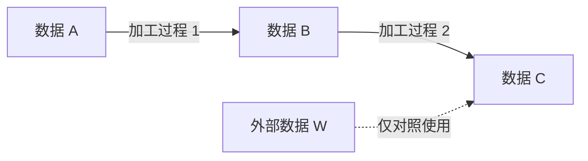

- 箭头上写**加工过程**（动词短语），不是「→」。一份数据被多个下游使用就画多条边。
- `processing` 只补图和 Pipeline 表达不了的：被谁读过、做过哪些一次性处理。

## P10 要素规模：怎么上报「哪个要素到了哪一步」

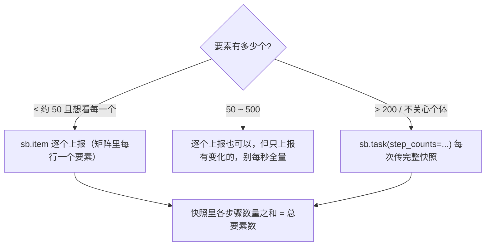

- `step_counts` 是**整体替换**：每次必须传完整的各步骤数量，不是增量。
- 上限：items 最多 500 个。

## P11 纯步骤流（不处理数据）


- 不需要数据图，节点也不用 `reads/writes`；状态用 `sb.node("pipelines", gid, nid, status=..., note=...)`，有耗时的步骤再挂普通任务。

## P12 成果校验：怎么建一个校验集

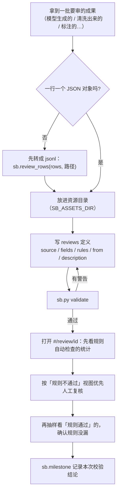

**fields 怎么选**

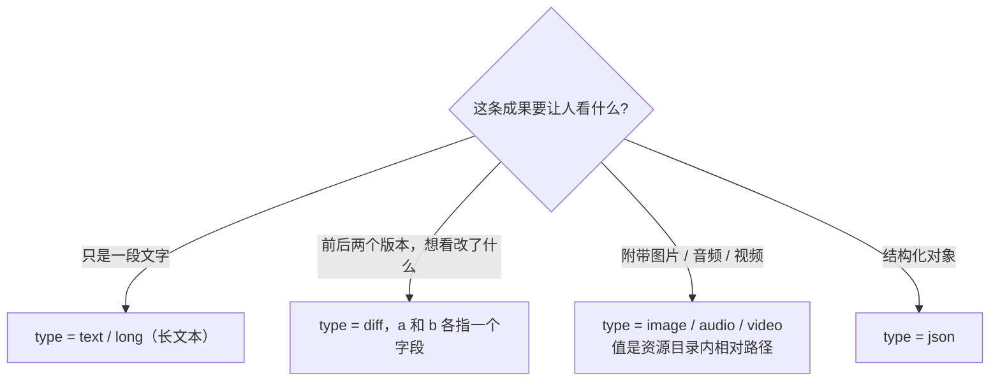

**rules 怎么写**

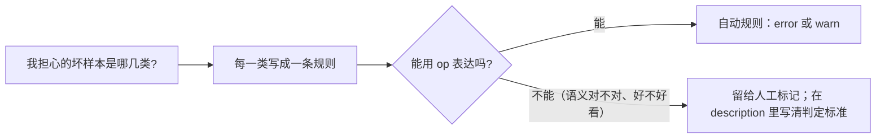

- 规则只是**帮人把注意力放对地方**，不替代人工判断：规则通过的样本也要抽样看，确认规则没有漏掉。
- 没把握的统计口径别写进规则（比如"回答是否正确"），交给人工标记，并在 `description` 写清判定标准。
- 想表达"字段可以没有，但有就必须满足某条件"：拆成两条规则，不要靠一条规则同时表达。
- `unique` 对大文件会占内存（上限约 50 万个值），只对确实需要去重的字段用。

## P13 资源管理：登记什么、怎么处理密钥

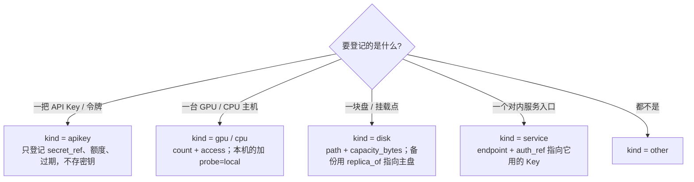

**手里有一个密钥时，怎么登记**

```mermaid
flowchart TD
    A["拿到一个密钥"] --> B{"它现在存在哪?"}
    B -->|"环境变量里"| E["secret_ref = {env: 变量名}"]
    B -->|"某个文件里"| F["secret_ref = {file: 绝对路径}<br/>并确认文件权限是 600"]
    B -->|"团队密钥库里"| V["secret_ref = {vault: 条目名}"]
    B -->|"只在我手里，哪都没存"| N["先把它存到上面三处之一，再登记<br/>不要为了登记而把它写进任何文件"]
    E --> R["写 resources 定义（只有来源，没有内容）"]
    F --> R
    V --> R
    N --> R
    R --> T["sb.py validate：不应有任何密钥相关的错误"]
```

> 如果 `validate` 或写入报「疑似密钥」：说明某处出现了密钥内容。**先去源头删掉它**（并视情况轮换密钥），再重写定义。不要想办法绕过检测。

**静态信息与动态信息分开存**

```mermaid
flowchart LR
    A["定义 resources/池.json<br/>是什么 · 怎么取 · 额度多少 · 谁负责"] -->|"很少变化"| P["资源池页面"]
    B["用量 usage/池.json<br/>已用额度 · 谁占了多少 · 状态覆盖"] -->|"sb.resource 持续上报"| P
    C["本机探测 probe=local<br/>GPU 逐卡 · CPU 负载 · 磁盘用量"] -->|"后台线程 · 5 秒缓存"| P
    P --> W["首页「需要关注」<br/>异常 / 需关注的资源"]
```

- **分配是整体替换**：每次上报当前完整的占用清单，释放就是上报时去掉那一项。
- **别的机器的 GPU**：看板不会主动连远程地址。在那台机器上跑脚本，把 `used` / `metrics` 通过 `sb.resource` 报上来（远程上报用 `SB_URL`）。
- 资源不再使用：先把 `state` 置为 `revoked` / `disabled` 留痕，确认无人引用后再从定义里删除（删除会进入时间线）。

---

## 任务生命周期

```mermaid
stateDiagram-v2
    [*] --> queued: 创建
    queued --> running: 开始
    [*] --> running: 直接开始
    running --> running: 上报进度 / 心跳
    running --> done: 完成
    running --> failed: 出错
    running --> cancelled: 取消
    failed --> running: 重试
    done --> [*]
    cancelled --> [*]
```

`running` 超过 `stale_after` 秒无上报，页面标「疑似停滞」（不改变真实状态）。
