# 拓扑与建模模式（抽象版，故意不含任何业务内容）

这里只画「形状」，节点名都是占位（步骤 1、数据 A …）。真实内容必须来自你面对的项目。
需要看某个字段的具体写法时，再去 `examples/` 找对应形状的范例。

## 先判断：你的流程属于哪种形状

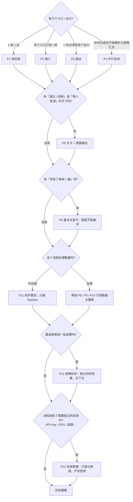

---

## P1 线性链

- 记法：每个节点写 `role`（一句话作用）+ `desc`；边不用写 `label`，除非传递物值得说明。
- 常见误用：把一个步骤拆成十几个小节点。节点是读者想单独看进度/作用的单位，不是函数调用栈。

## P2 扇入（多个来源汇到一处）

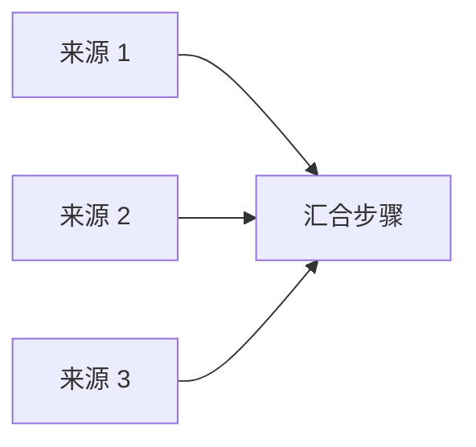

- 记法：每个来源一个节点，各自可挂各自的任务；汇合步骤的 `reads` 列出全部上游数据。
- 一个来源缺失时：让汇合步骤的 `desc` 写清缺失时的处理方式，并在该来源节点的 `note` 里记下这次缺失。
- 注意：若有 `kind="run"` 任务的要素已流经下游，服务会按图的先后关系把上游节点推导为「已完成」，**覆盖** `sb.node` 手工置的 `skipped`。所以缺失要靠 `note` 和任务的 `message` 表达，不要只依赖手工状态。

## P3 扇出（一处分流到多个出口）

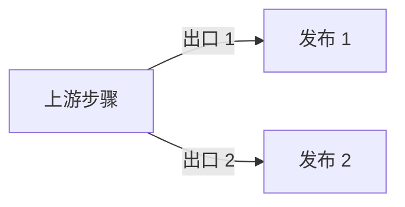

- 记法：边的 `label` 写分流条件或传递物。出口之间若有先后（先 1 后 2），画成链，不要画成扇出。

## P4 并行支线再汇合

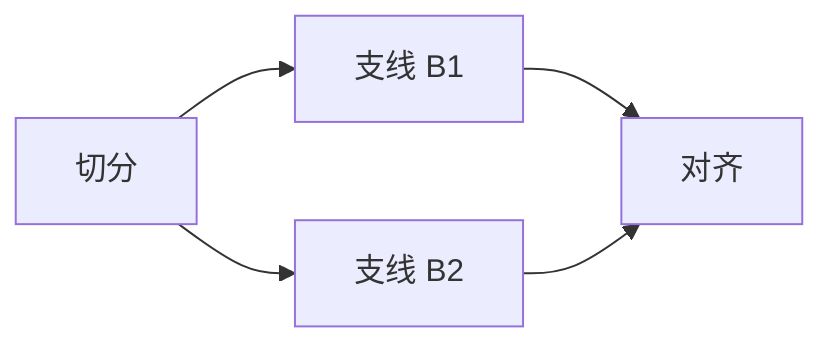

- 要点：一个**要素**同一时刻只位于一个步骤。要追踪「要素在并行支线上的位置」时，把「要素 × 支线」各当一个要素：

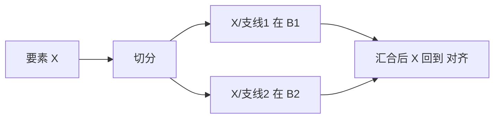

- 「要素 × 步骤」矩阵里，不在某条支线上的格子显示「不经过」，是正确的，不是漏记。

## P5 关卡与旁路输出

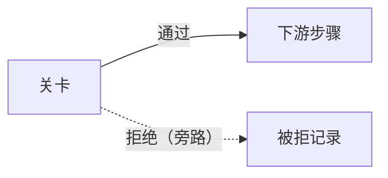

- 记法：关卡节点 `kind="gate"`。被拒的东西**要保存**并作为数据资产记录（`R`），写明拒绝原因去向。
- 人工审批：关卡节点 `status="running"` + `note` 写清「在等谁、等什么」，批准后置 `done`。

## P6 重试与迭代：图里不能画环

`validate` 会把环当成**错误**（布局需要无环）。需要表达「再来一遍」时三选一：

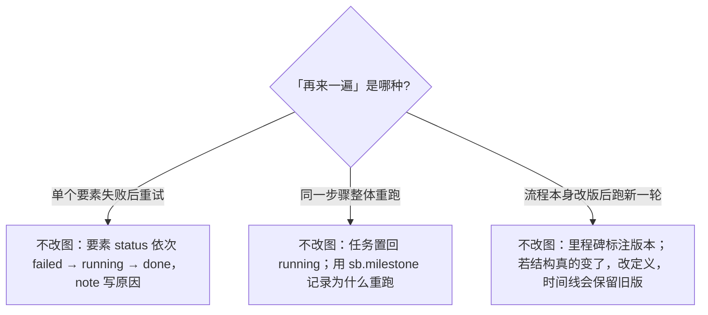

## P8 数据：多个地址（副本）

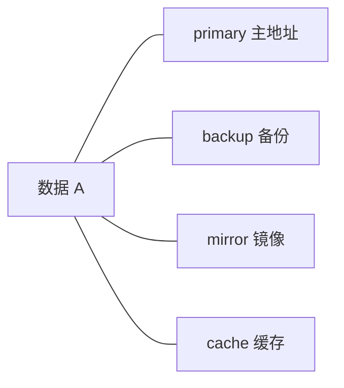

- 记法：`locations` 每个副本一条：`label`、`role`、`storage`、`path`、`note`（同步方式/延迟）。**有几个地址就写几条，不要只写主地址。**
- `role` 取值：`primary backup mirror remote cache`。本机路径加 `auto_stat` 会统计大小并比对副本是否一致。
- 不知道备份在哪就不要写；用 `note` 或 `processing` 注明「备份位置待确认」。

## P9 数据血缘（加工关系）

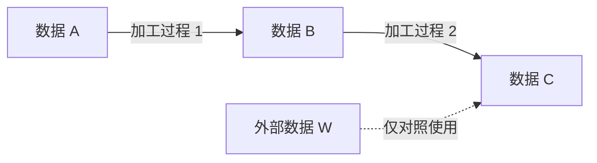

- 箭头上写**加工过程**（动词短语），不是「→」。一份数据被多个下游使用就画多条边。
- `processing` 只补图和 Pipeline 表达不了的：被谁读过、做过哪些一次性处理。

## P10 要素规模：怎么上报「哪个要素到了哪一步」

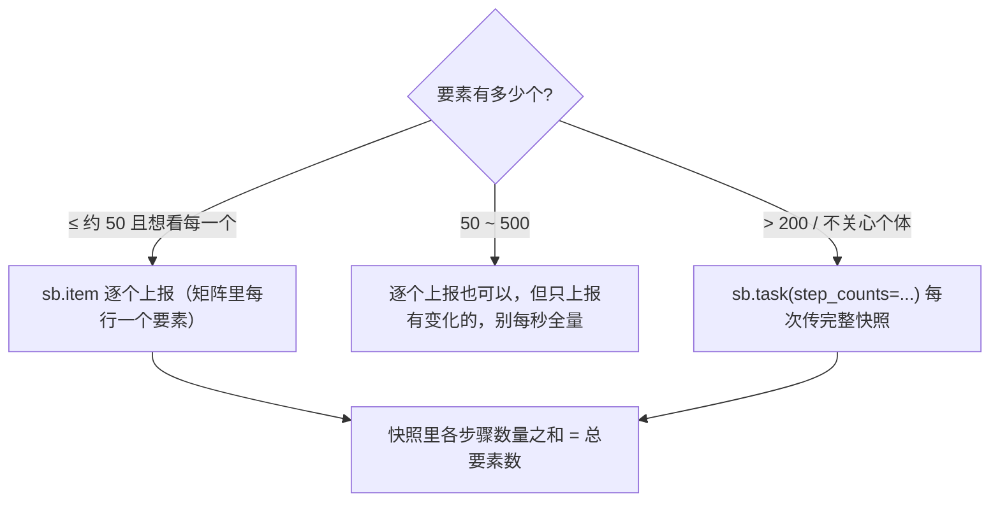

- `step_counts` 是**整体替换**：每次必须传完整的各步骤数量，不是增量。
- 上限：items 最多 500 个。

## P11 纯步骤流（不处理数据）

- 不需要数据图，节点也不用 `reads/writes`；状态用 `sb.node("pipelines", gid, nid, status=..., note=...)`，有耗时的步骤再挂普通任务。

## P12 成果校验：怎么建一个校验集

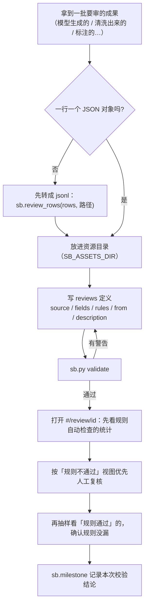

**fields 怎么选**

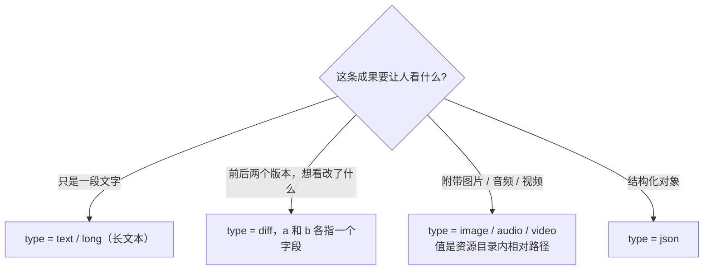

**rules 怎么写**

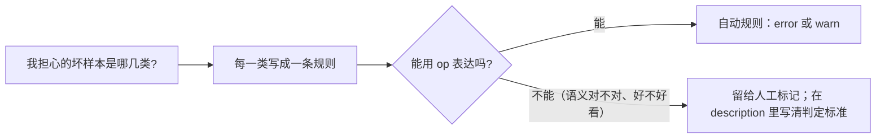

- 规则只是**帮人把注意力放对地方**，不替代人工判断：规则通过的样本也要抽样看，确认规则没有漏掉。
- 没把握的统计口径别写进规则（比如"回答是否正确"），交给人工标记，并在 `description` 写清判定标准。
- 想表达"字段可以没有，但有就必须满足某条件"：拆成两条规则，不要靠一条规则同时表达。
- `unique` 对大文件会占内存（上限约 50 万个值），只对确实需要去重的字段用。

## P13 资源管理：登记什么、怎么处理密钥

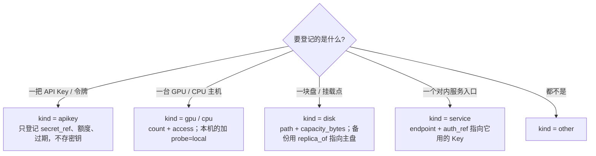

**手里有一个密钥时，怎么登记**

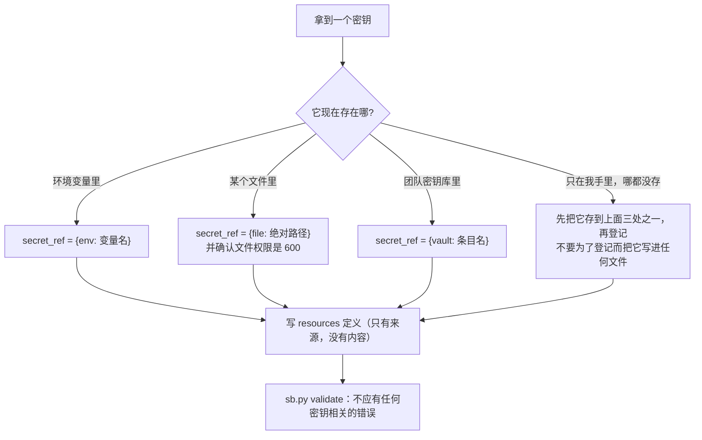

> 如果 `validate` 或写入报「疑似密钥」：说明某处出现了密钥内容。**先去源头删掉它**（并视情况轮换密钥），再重写定义。不要想办法绕过检测。

**静态信息与动态信息分开存**

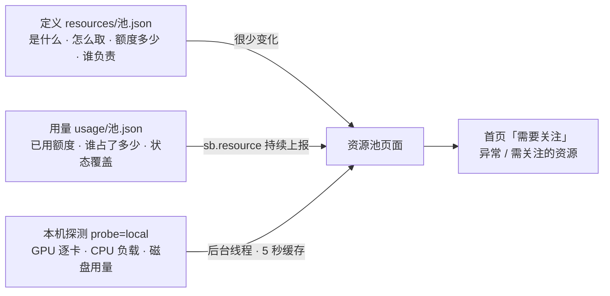

- **分配是整体替换**：每次上报当前完整的占用清单，释放就是上报时去掉那一项。
- **别的机器的 GPU**：看板不会主动连远程地址。在那台机器上跑脚本，把 `used` / `metrics` 通过 `sb.resource` 报上来（远程上报用 `SB_URL`）。
- 资源不再使用：先把 `state` 置为 `revoked` / `disabled` 留痕，确认无人引用后再从定义里删除（删除会进入时间线）。

---

## 任务生命周期

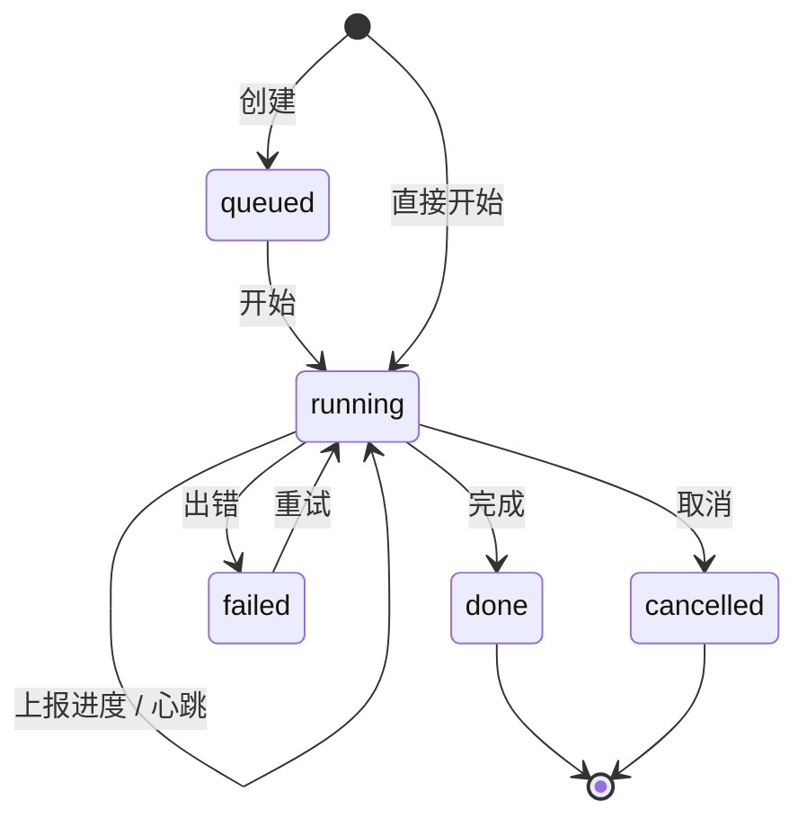

`running` 超过 `stale_after` 秒无上报，页面标「疑似停滞」（不改变真实状态）。
